# Class diagram

Status: draft for team review, 2026-10-31. Part 1 covers layer 1: the progress entities and the level schema. Part 2 covers layer 2: the use cases and their ports. Part 3 covers layers 3 and 4: the adapters and the drivers.

This page answers statement §4.1 for the API, as decision D6 asks (it replaces assumption A9). It shows the generic types in UML template notation, the layer of each class, and the design patterns. Each view shows at most seven classes and eight relationships. IDs such as A5, D6 and Q10 refer to [`docs/REQUIREMENTS.md`](../REQUIREMENTS.md). DS-4, DS-5 and DS-6 are the data shape decisions of its §4. The layers themselves are in [layers.md](layers.md). The extension points are in [extensibility.md](extensibility.md). The use case flows are in [flows.md](flows.md).

## Whole model in draw.io

[`classes.drawio`](classes.drawio) holds the whole class model in one draw.io file, with 4 pages. Open it in draw.io or diagrams.net.

- Page 1, `All classes`, holds every class, interface and type of the model once, by layer: layer 4 at the top and layer 1 at the bottom, so every dependency points down.
- Pages 2 to 4, `Domain`, `Use cases` and `Adapters`, hold one part each. A part page shows the types of its part in full. A grey box with the name only is a type of another part that one of its lines touches, and its eyebrow names the page that details it.
- A solid box is a type that exists in the code at `94b912d`. A dashed box with `«planned»` is design from the views of this page that the code does not have yet. It keeps the `«Sprint N»` of its view when the view gives one.
- `members not designed yet` marks a planned class that no view details.
- `«dataType»` marks a type in the code that only carries data; it has no operations by design. `«module»` marks `AppModule`, a Nest module that only holds decorator metadata.
- The pages follow the reading rules of the next section, and each page has a legend.

The file is generated from the code at `94b912d` plus the views of this page. A hand edit is lost at the next generation.

## How to read it

- The colored zone is the Clean layer, with the colors of [layers.md](layers.md): yellow for layer 1, purple for layer 2, light blue for layer 3 and dark blue for layer 4.
- One view can show several layers. The zones are bands, with the outer layer at the top and the inner layer at the bottom, so every dependency between layers points down.
- A dashed frame groups the classes of one GoF pattern or one group. Its label names the source, for example `STRATEGY · §3.3 · DS-6`. A frame is not a class. No line starts or ends on a frame. When two classes of different groups depend on each other, the line joins those two classes. A line from one frame to another frame would claim that every class of the first group uses every class of the second group, and that is usually false. The professor asked this about a frame-to-frame arrow in the session of 2026-11-03: «todas esas usan los tres bloques de abajo, a lo mejor la respuesta es no».
- A stereotype such as `«Strategy»` marks the role of one class in that pattern. `«port»` marks an interface that an outer layer implements. `«repository»` marks a repository: the port in layer 2 and its adapter in layer 3. A domain class carries its tactical stereotype: `«entity»`, `«aggregate root»` or `«value object»`.
- An underlined member is static, as in UML.
- The dashed box at the top right of a class holds its type parameters. This is the UML template notation that §4.1 asks for.
- A `«bind»` label on a realization or an inheritance line names the type that each parameter takes, for example `«bind» TSection → FitSection`.
- The teal class is the focal class of the view.
- A lollipop (a circle on a short line) is the input port that a use case implements.
- A dashed class with no members is a class that another view details. Its eyebrow names that view, for example `PART 2 · VIEW 2`.
- Under the name of a class, an ID such as `API-FR-04` names the requirement it serves.
- A diamond marks an attribute only where it makes a GoF pattern visible, and only between two classes of one layer: hollow (aggregation) when the value comes from outside, filled (composition) when the class creates it. Example: `LevelValidators` holds its `LevelValidator` strategies (a Strategy registry). The other end names the attribute and its multiplicity, even when it is 1. Any other attribute is a use arrow with the same role and multiplicity, a domain relation included: `PlayerProgress` keeps its `LevelResult` values, and `LevelDefinition` holds its section. The attribute already shows in the class box, so a diamond adds nothing there. In the class of 2026-11-02 the professor kept the diamond for one reason: «Aquí sí porque quiero hacer visible el patrón estratégico».
- A solid line with an open arrowhead is a use: the class depends on the other class. It points from the class that holds or calls to the class it needs. When the other class is an attribute with no pattern to show, or an attribute across layers, the label names the attribute and its multiplicity. A port counts as across layers: it lives in layer 2, and its adapter lives in layer 3 or 4. When the other class is only a parameter, a return value, a local variable or a `new`, the label is a verb. A link that is none of these, such as a guard that a decorator applies or a class that a module only names in its metadata, gets no line; the box or the note names it. This follows the class of 2026-11-02 (decision 13), which replaces the diamond rule of the board of the class of 2026-10-02.
- The legend of each view lists only the line kinds that the view draws.
- The views do not mark which classes are planned. Today `src/` holds the user and progress classes of the domain, the account and progress use cases with their ports, their adapters, `LoggingAspect` and `AppModule`. The level classes, the leaderboard classes and `TimingAspect` are planned.

## Part 1: the domain

`src/domain/`, layer 1. It imports nothing outside `src/domain/` (rule `domain-imports-only-domain`).

### View 1.1: progress and level results

### View 1.2: the level schema

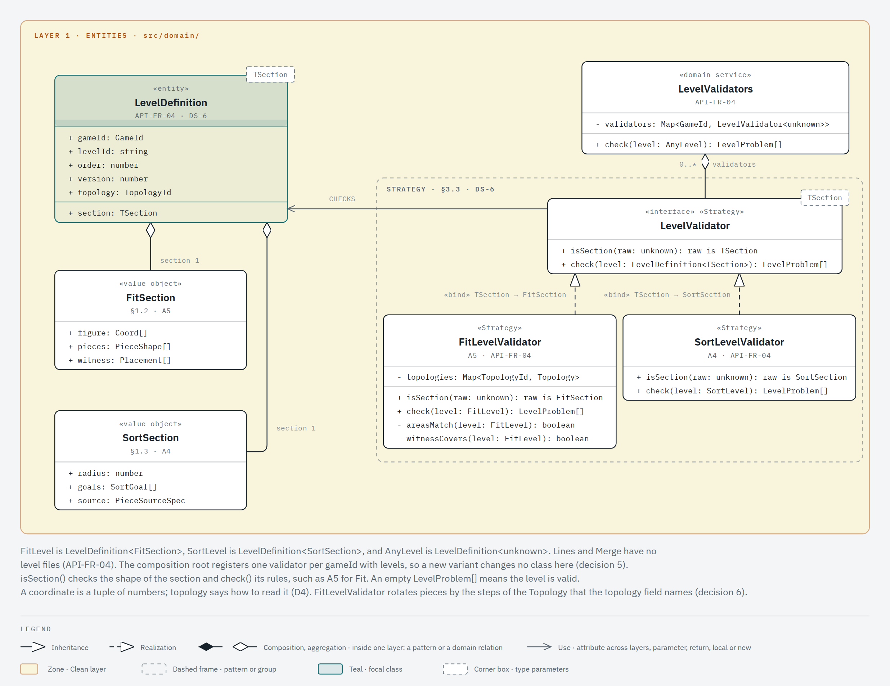

### View 1.3: the user and its credential values

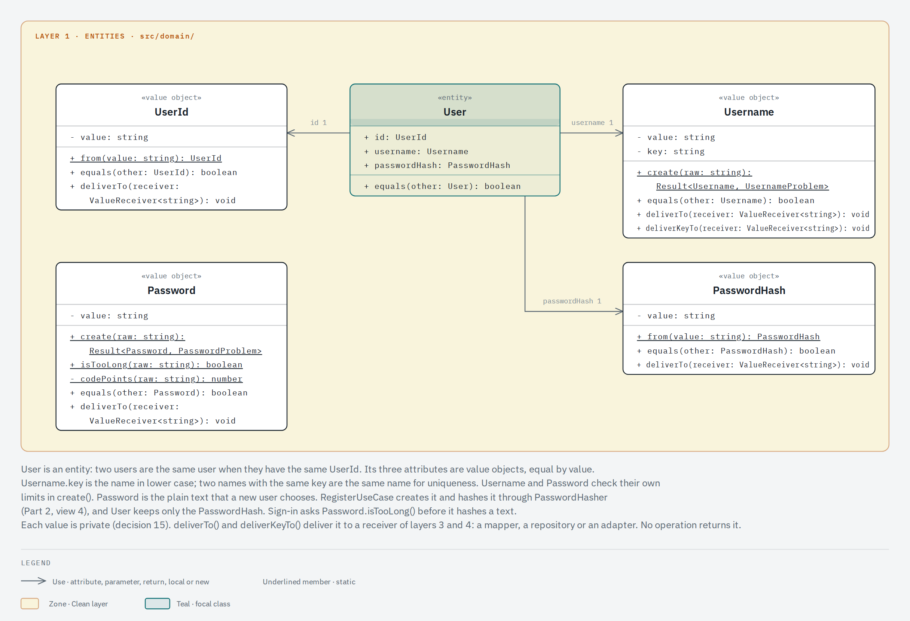

### View 1.4: the level result and its values

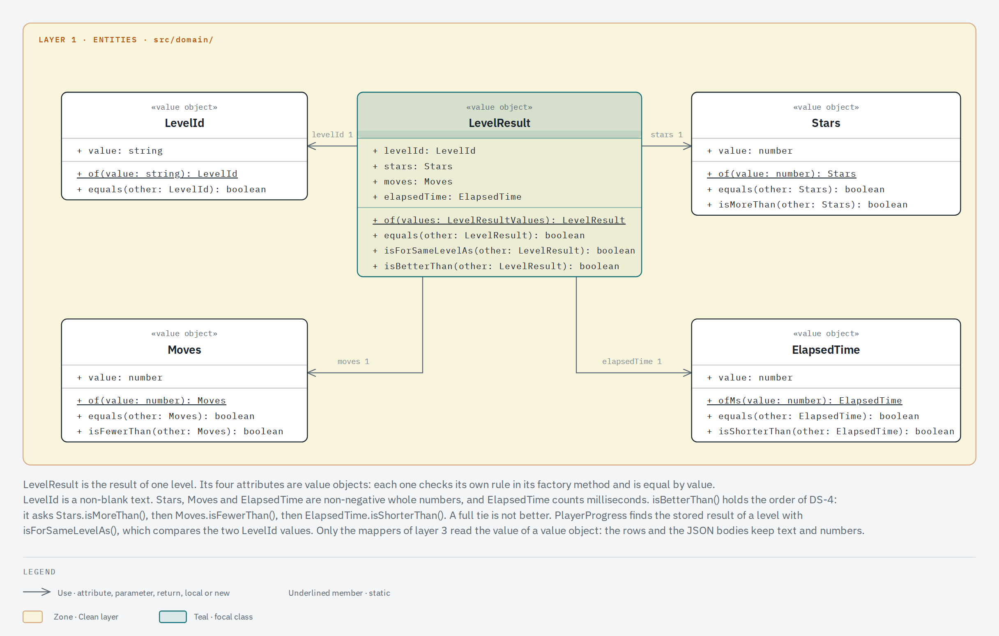

## Part 2: the use cases

`src/application/`, layer 2. It imports only `src/domain/` and `src/application/` (rule `application-imports-only-domain`). The ports live here (Q10).

### View 2.1: the use case contract and its aspects

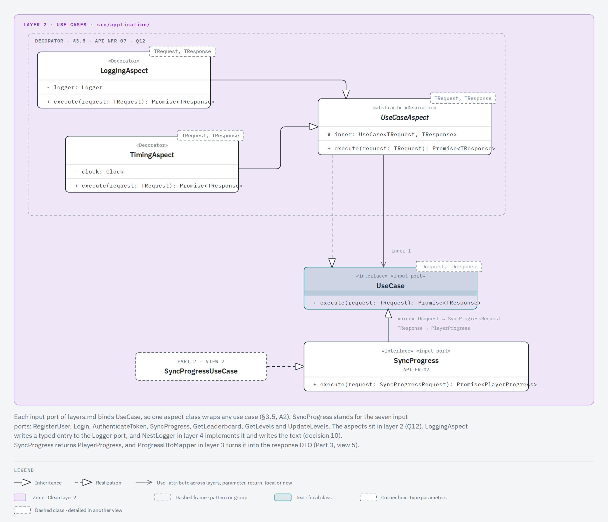

### View 2.2: progress and leaderboard

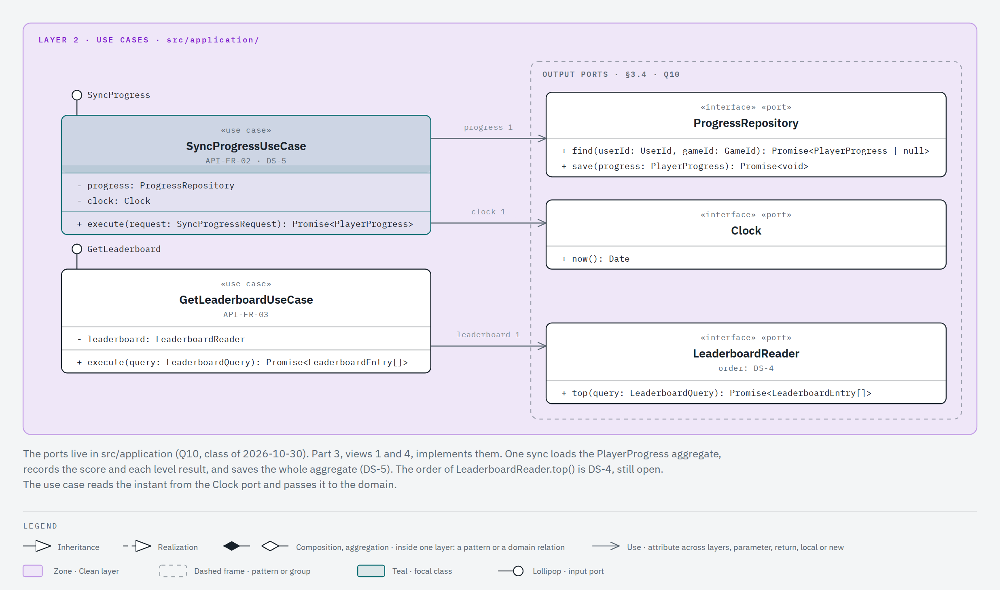

### View 2.3: levels

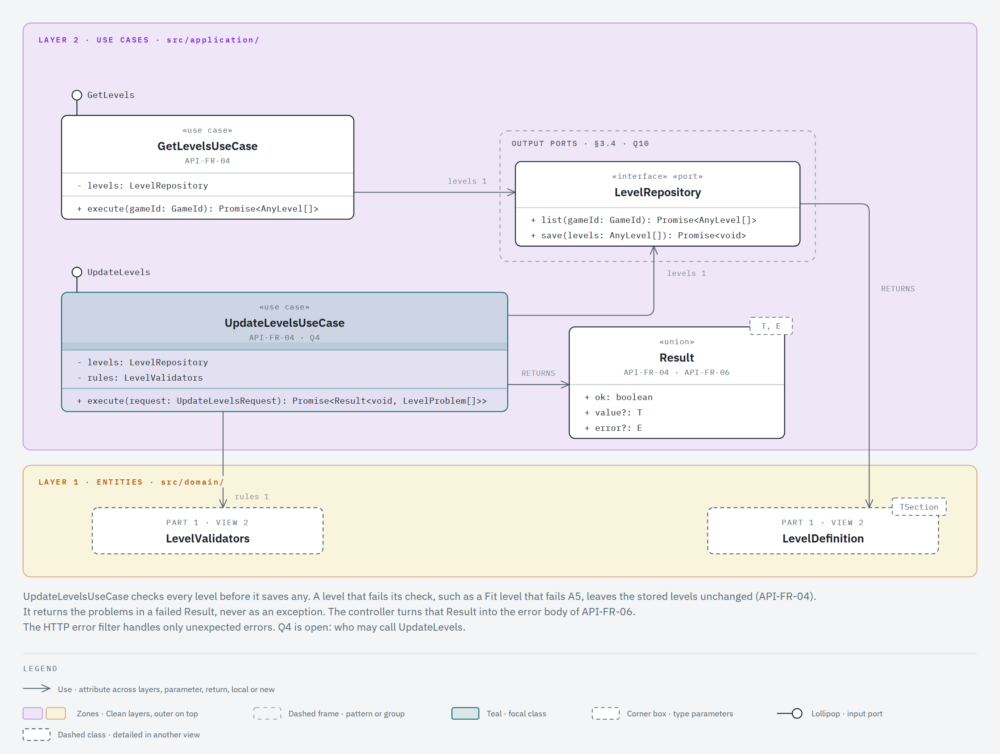

### View 2.4: account

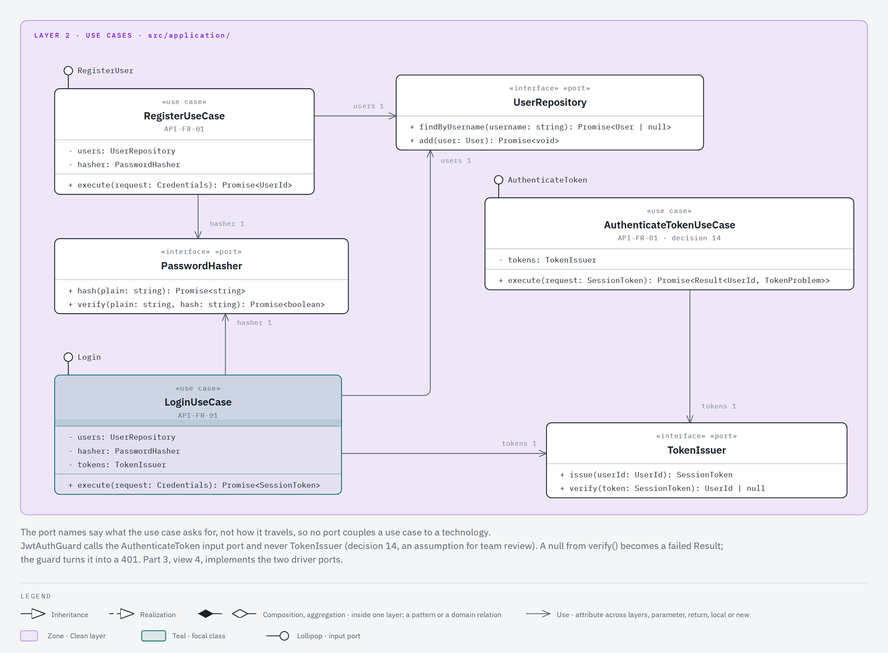

## Part 3: adapters and drivers

Layer 3, `src/adapters/`, and layer 4, `src/infrastructure/`. Adapters never import `src/infrastructure/` (rule `adapters-never-import-infrastructure`). The persistence adapters never import Nest (rule `persistence-adapters-never-import-nest`).

### View 3.1: progress store

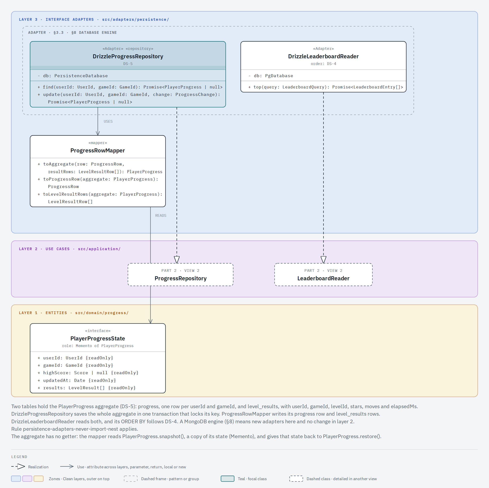

### View 3.2: level and user store

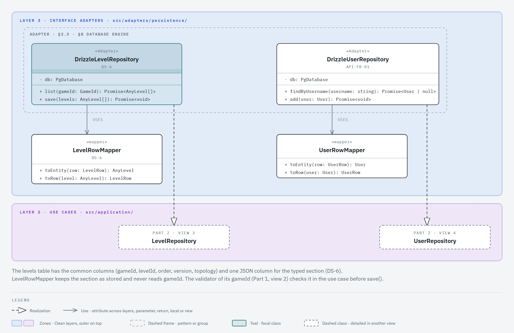

### View 3.3: HTTP

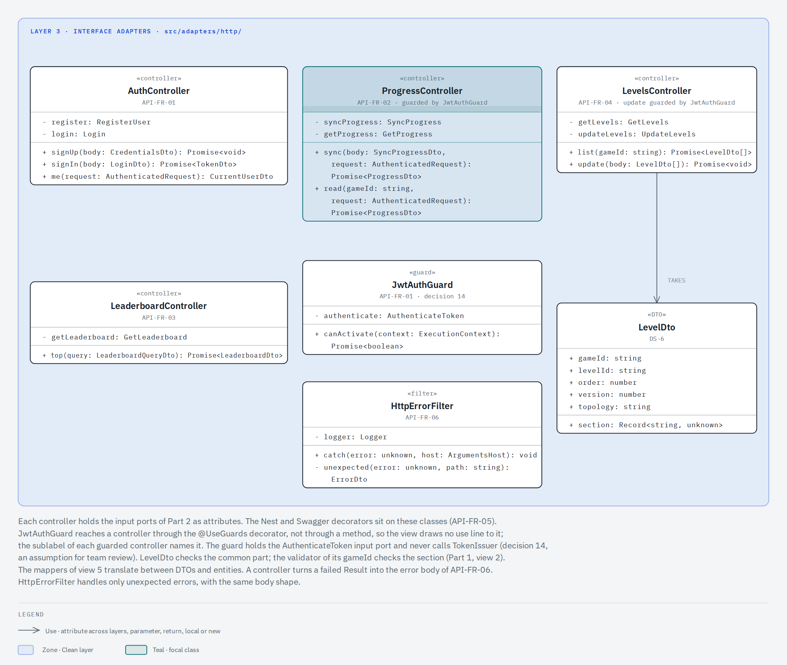

### View 3.4: wiring

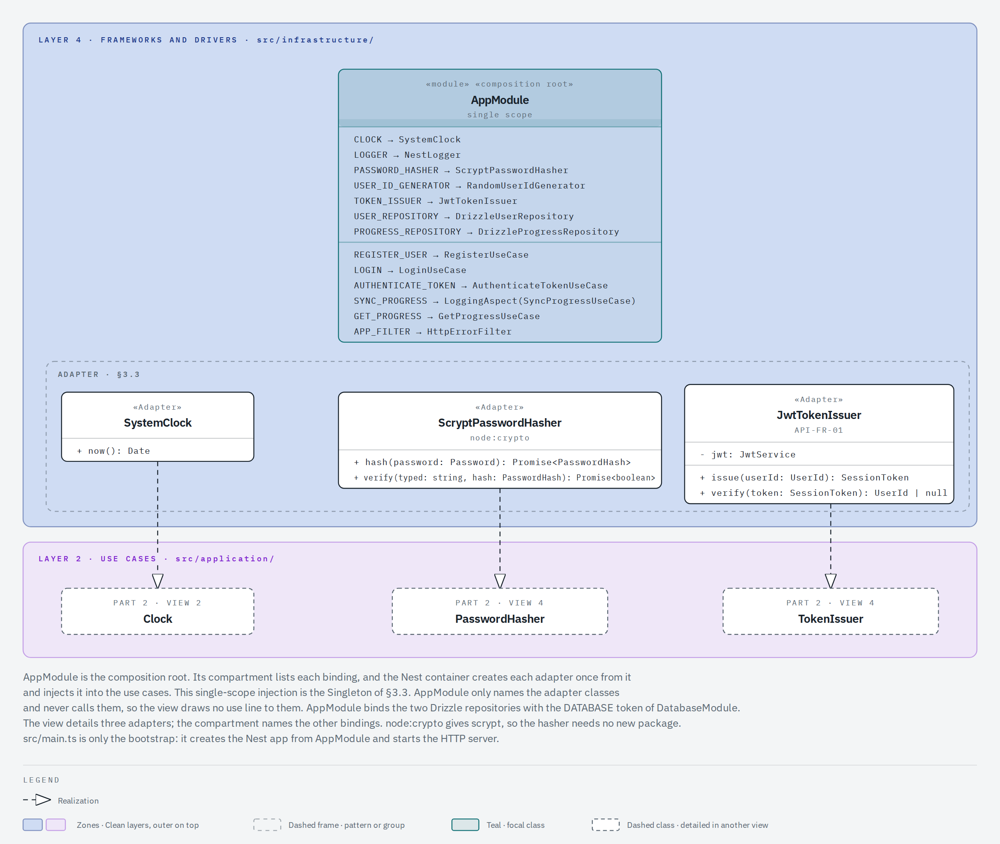

### View 3.5: HTTP mappers

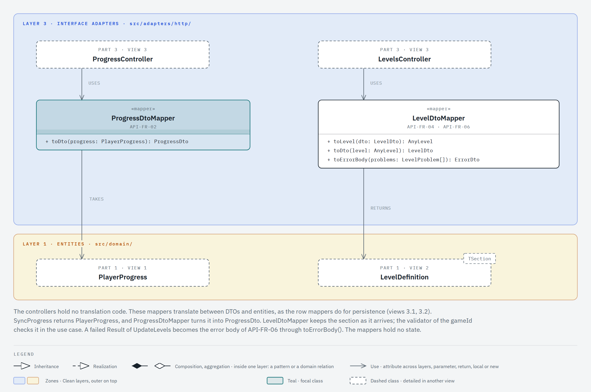

## Use case slices

One use case can cross every layer. [flows.md](flows.md) follows one request through the layers for each path that shows something new: a class view of that use case only, and a UML sequence diagram with the same class names. Its table «Other use cases» names the path that each other use case follows.

### Slice 1: sync progress

### Slice 2: login

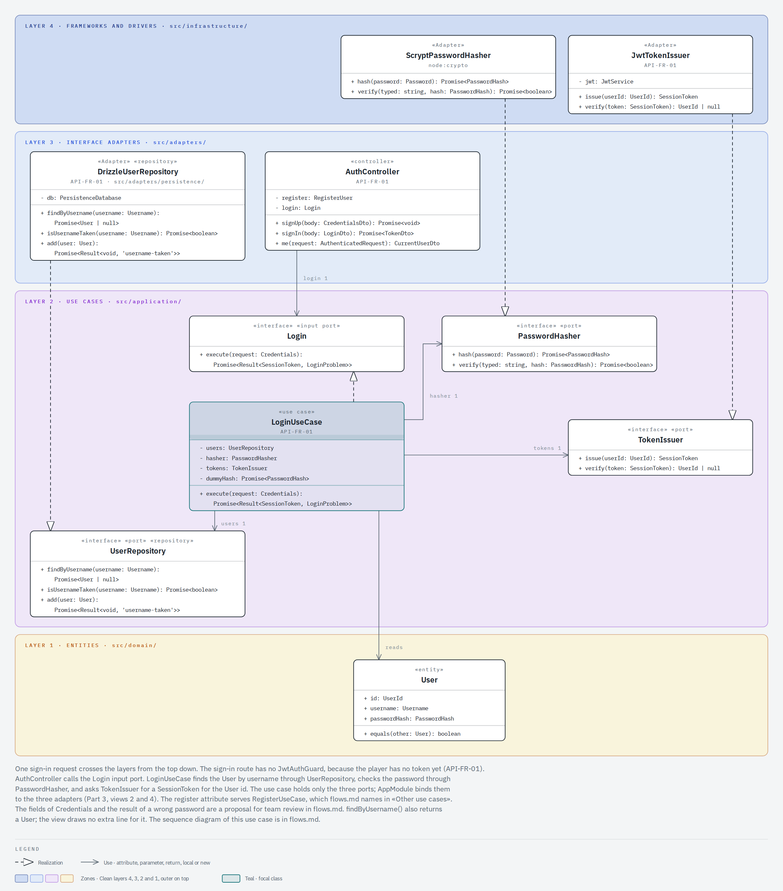

### Slice 3: update levels

## Data shapes

The team closed two data shape decisions on 2026-10-30. The app draws the same names on its side.

**DS-5: two tables for progress** (option «B · Dos tablas»). It serves API-FR-02 and API-FR-03.

| Table           | Key                           | Other columns                 | Read by                                   |
| --------------- | ----------------------------- | ----------------------------- | ----------------------------------------- |
| `progress`      | `userId`, `gameId`            | `highScore`, `updatedAt`      | sync, global leaderboard per `gameId`     |
| `level_results` | `userId`, `gameId`, `levelId` | `stars`, `moves`, `elapsedMs` | sync, per-level leaderboard for Fit, Sort |

**DS-6: one level schema, a common part and a typed section** (option «A · Común + sección tipada»). It serves API-FR-04.

| Part         | Fields                                              | Checked by                         |
| ------------ | --------------------------------------------------- | ---------------------------------- |
| Common       | `gameId`, `levelId`, `order`, `version`, `topology` | `LevelDto` (shape)                 |
| Fit section  | `figure`, `pieces`, `witness`, `stars`              | `FitLevelValidator` (shape and A5) |
| Sort section | `radius`, `goals`, `source`, `stars`                | `SortLevelValidator` (shape)       |

The Fit `stars` field is a list of `FitStarThreshold`, each one a `maxMoves` count and a `maxElapsedMs` time, and a Fit star needs both ([hexablock-app#60](https://github.com/Hexablock-Suite/hexablock-app/issues/60), 2026-11-06). The Sort `stars` field is a list of `SortStarThreshold`, each one a `maxMoves` count (stars by moves, [hexablock-app#59](https://github.com/Hexablock-Suite/hexablock-app/issues/59), 2026-11-06). In both sections the stars are cumulative: star N needs star N-1.

The API rejects a Fit level that fails A5: the piece areas differ from the figure area, or the witness does not cover the figure exactly. `UpdateLevelsUseCase` checks every level before it saves any level.

**DS-4 is closed** (2026-11-06, [#24](https://github.com/Hexablock-Suite/hexablock-api/issues/24)). The best result of a level has more stars; on equal stars, fewer moves; on equal moves, less time. On a full tie, the stored result stays. `LevelResult.isBetterThan()` holds this order: it asks `Stars.isMoreThan()`, then `Moves.isFewerThan()`, then `ElapsedTime.isShorterThan()`. `PlayerProgress.recordLevel()` keeps the best result of each level (DS-12). The same order ranks the per-level leaderboard of Fit and Sort. `LeaderboardReader` and its Drizzle adapter are not built yet.

## Patterns

D7 asks for a written reason for each pattern. The Reason column names the requirement behind it. In the Views column, `2.1` is view 1 of part 2.

| Pattern                            | Classes                                                                           | Reason                                                                                                                 | Views         |
| ---------------------------------- | --------------------------------------------------------------------------------- | ---------------------------------------------------------------------------------------------------------------------- | ------------- |
| Strategy                           | `LevelValidator`, `FitLevelValidator`, `SortLevelValidator`                       | Mandatory (§3.3). Each `gameId` with levels registers the validator that checks its section (DS-6, API-FR-04, A5).     | 1.2           |
| Decorator                          | `UseCaseAspect`, `LoggingAspect`, `TimingAspect`                                  | The aspects of §3.5 wrap any use case and add no code to it (API-NFR-07, A2). Q12 put them in layer 2.                 | 2.1           |
| Adapter                            | The Drizzle repositories; `SystemClock`, `ScryptPasswordHasher`, `JwtTokenIssuer` | A new database engine means new adapters, and the use cases do not change (§3.3, §3.4, the database engine row of §8). | 3.1, 3.2, 3.4 |
| Singleton (single-scope injection) | `AppModule` and its providers                                                     | One instance of each adapter for the whole API (§3.3: «Singleton (o inyección de dependencias con alcance único)»).    | 3.4           |
| Memento                            | `PlayerProgress` and its `PlayerProgressState`                                    | The aggregate has no getter: the mappers read a copy of its state, and `restore()` builds it again (decision 2).       | 1.1, 3.1, 3.5 |

Abstract Factory is also mandatory in §3.3. The app holds it: one factory per variant. The API does not use it. See decision 8.

## Why each abstraction exists

Every abstraction cites a requirement, a declared variation or a layer boundary. A class with no citation stays a plain class.

| Abstraction                                    | Reason                                                                                                                  |
| ---------------------------------------------- | ----------------------------------------------------------------------------------------------------------------------- |
| `UseCase<TRequest, TResponse>` and input ports | Layer boundary: the controllers depend on the interface (layers.md). One aspect wraps any use case (§3.5).              |
| Output ports (`ProgressRepository` and others) | Layer boundary (§3.4, Q10). The database engine row of §8.                                                              |
| `PasswordHasher`, `TokenIssuer`, `Clock`       | Layer boundary: the use cases do not read the system clock or a crypto library (API-NFR-11, rule R-deterministic-core). |
| `Result<T, E>`                                 | A use case returns an expected failure as a value. No exception crosses the input port to the HTTP layer.               |
| `LevelDefinition<TSection>`                    | DS-6: one schema with a typed section per `gameId`. Generics are required (D6).                                         |
| `LevelValidator<TSection>`                     | DS-6: each variant validates its own section. A5 for Fit (API-FR-04).                                                   |
| `Range<T>`                                     | Credential limits (#60): `Username`, `Password`, the HTTP messages and `CredentialsDto` read one range (D6).            |

Plain classes: `LevelValidators`, the row mappers, the HTTP mappers, `LeaderboardEntry`, the controllers, `LevelDto`, the guard and the filter. `PlayerProgressState` is a plain data type with no tactical stereotype: it is the Memento of `PlayerProgress` (decision 2). `LevelValidators` is a registry: the composition root fills it, so it needs no interface of its own.

## Decisions to check with the team

1. **Ports in the application layer.** The class of 2026-10-30 answered Q10: the ports belong to the application layer. Every port in this diagram is in `src/application/`, and the code has `Clock` in `src/application/ports/clock.ts`. Domain code never imports a port: a method such as `recordScore(score, at)` takes the instant as a parameter.
2. **One progress aggregate over two tables (DS-5).** The domain comes first: `PlayerProgress` is the aggregate root, one per `userId` and `gameId`. It keeps its `LevelResult` values and is the only way to record one, so `LevelResult` has no repository and no `userId` or `gameId` of its own. `ProgressRepository` reads the whole aggregate with `find()` and changes it with `update(userId, gameId, change)`. `update()` holds a lock for the `userId` and `gameId`, passes the stored aggregate or `null` to the change, and saves the whole aggregate that the change returns. So two overlapping syncs of one key run one after the other. The rules, such as the highest score, stay in the domain; the adapter adds none. `DrizzleProgressRepository` splits it into the two tables of DS-5: `progress` keeps one row per `userId` and `gameId`, and `level_results` keeps `userId`, `gameId`, `levelId`, `stars`, `moves` and `elapsedMs`. The aggregate keeps only the best result of each level (DS-12) by the order of DS-4: `recordLevel()` keeps a new result only when `LevelResult.isBetterThan()` ranks it above the stored one. The aggregate has no getter and no public field (design decision of 2026-11-09). `PlayerProgress.snapshot()` gives a `PlayerProgressState`, a copy of its state in domain types: the `UserId`, the `GameId`, the `Score` or `null`, the `Date` of `updatedAt` and the `LevelResult` values. A change to the copy does not change the aggregate. `ProgressRowMapper` and `ProgressDtoMapper` read that copy, and `PlayerProgress.restore()` builds the aggregate again from the same type. This is the Memento of Millett and Tune: the aggregate hides its state, and the repository maps the snapshot to the data model (views 1.1, 3.1 and 3.5). The aggregate keeps its results in a list and finds the stored result of a level with `LevelResult.isForSameLevelAs()`, which compares two `LevelId` values with `equals()`. It keeps no map with a text key taken out of the `LevelId` (design decision of 2026-11-09); a game has few levels, so the list is enough. `LeaderboardReader` stays a read model.
3. **The progress row fields (proposal).** DS-5 fixes the key. `highScore` and `updatedAt` are our proposal: the app keeps a high score for Lines and Merge, and the use case reads the instant from the Clock port and passes it to the domain. In the domain the high score is a `Score` value object, not a number (design decision of 2026-11-09: no primitive crosses a public signature of the domain model, the boolean excepted). `Score.of()` guards the rule: a score is a non-negative safe integer. `Score.isHigherThan()` tells which of two scores wins, and `PlayerProgress.recordScore()` keeps the higher one. A progress with no score yet holds `null`, so it differs from a score of 0. The `high_score` column and the JSON bodies keep a number: only `ProgressRowMapper` and `ProgressDtoMapper` read the number of a `Score`, and `ProgressDtoMapper` builds the `Score` of a sync from the body. The same decision holds for a level result (view 1.4): `LevelResult` holds a `LevelId`, a `Stars`, a `Moves` and an `ElapsedTime` value object, not a string and three numbers. `LevelId.of()` guards a non-blank text. `Stars.of()`, `Moves.of()` and `ElapsedTime.ofMs()` each guard a non-negative safe integer, and `ElapsedTime` counts milliseconds. Each one compares by value with `equals()`. The `level_results` columns and the JSON bodies keep text and numbers: only the two mappers read the value of these value objects, and `LevelResult.of()` builds them from the plain values of a row or a body. The four names are provisional until the team reviews them with the app.
4. **One generic level type (DS-6).** `LevelDefinition<TSection>` holds the common part, and `TSection` is `FitSection` or `SortSection`. `AnyLevel` is `LevelDefinition<unknown>`: a level whose section no validator has checked yet. `LevelDto` checks the shape of the common part in layer 3. The validator of each `gameId` checks the shape of its section and its rules in layer 1, for example A5 for Fit. Lines and Merge have no level files (API-FR-04).
5. **Validators registered by `gameId`.** `LevelValidators` holds a `Map<GameId, LevelValidator<unknown>>`, and the composition root fills it with one entry per variant that has levels. Each validator checks the shape of its section (`isSection()`) and its rules (`check()`). `LevelRowMapper` and `LevelDtoMapper` keep the section as they receive it and never read `gameId`. `GameId` is an open value object, not a closed list. So a new variant with levels adds a section type, a validator and one entry in the composition root, and it changes no existing class. A `gameId` with no entry has no level files, and an update for it fails with a level problem.
6. **Coordinates as tuples, rotation from the topology.** A coordinate is a tuple of numbers, and `topology` says how to read it. So a square, triangular or 3D level (§8, D4) needs no new schema. The A5 check rotates pieces, and the rotation steps come from the topology: `FitLevelValidator` holds the `Topology` objects registered by `TopologyId` and asks the one that the `topology` field names. The hexagonal topology has six steps of 60°. The code is ready for cells that are not hexagons: a new topology adds one `Topology` class and one entry, and the API never rejects a level only because its topology is not hexagonal. A level whose topology has no entry fails the check with a level problem.
7. **One generic input port.** Every input port of [layers.md](layers.md) binds `UseCase<TRequest, TResponse>`, for example `SyncProgress`. One aspect class then wraps any use case (§3.5). The app makes the same choice (its decision 9). The cost: an input port cannot add a second method.
8. **No Abstract Factory in the API.** In the API, a variant has one product: its level validator. A factory per variant would wrap one constructor. To check with the team: whether the professor expects the pattern in the backend too.
9. **Port names in the language of the game.** A port says what the use case asks for, not how the data travels. For example, `LeaderboardReader`, not a name that says SQL or HTTP. A name that says how the data travels couples the use case to that technology, as the class of 2026-10-30 explained.
10. **Aspects in layer 2, behind a `Logger` port.** In the session of 2026-11-06 the professor answered Q12: the aspects talk to the use case, so they belong in the application layer, built as decorators with one interface common to the use cases, without libraries. `UseCaseAspect` and `LoggingAspect` live in `src/application/aspects/`. `LoggingAspect` writes to the `Logger` port in `src/application/ports/logger.ts`, so `src/application` stays free of Nest. The port takes a typed entry (the use case name, the outcome, and the `kind` of a failure or the name, the string `code` and the stack frames of a thrown error), never a prebuilt `message: string`. `NestLogger` in `src/infrastructure/logging/` implements the port and writes the text. A failure logs only its `kind`, because the rest of a failure can hold values that the client sent. A thrown error never logs its message, for the same reason: the frames leave out the first line of the stack, which repeats the message, and a thrown value that is not an `Error` logs only its type ([#67](https://github.com/Hexablock-Suite/hexablock-api/issues/67)). The class of 2026-11-02 said that the message «no debería estar allí … En la implementación de este señor, en un adaptador secundario».
11. **Expected failures as values.** A use case never throws a domain error to the HTTP layer. `UpdateLevels` returns `Result<void, LevelProblem[]>`. `LevelsController` turns a failed result into the error body of API-FR-06. `HttpErrorFilter` handles only unexpected errors, with the same body shape.
12. **HTTP mappers.** `ProgressDtoMapper` and `LevelDtoMapper` in `src/adapters/http` translate between DTOs and entities, as the row mappers do for persistence. A controller holds no translation code. `SyncProgress` returns a `Result` with the `PlayerProgress`, and `ProgressDtoMapper` turns it into `ProgressDto`. `ProgressDtoMapper` also builds the domain values of each request (design decision of 2026-11-09): `SyncProgressRequest` carries a `GameId`, an optional `Score` and the `LevelResult` values, and `GetProgressRequest` carries a `GameId`. So a use case never builds a domain value from a loose primitive. The mapper builds the values in one order: the `gameId`, the results, then the score. A value that breaks its rule stops in the mapper: the controller answers 400 with the message of the first broken rule in that order, the request reaches no use case, and `LoggingAspect` writes no entry for it.
13. **Use arrows for attributes, diamonds only for a visible pattern.** In the class of 2026-11-02 the professor asked for explicit dependencies (use, extend, implement) between layers, and for a composition or aggregation diamond only where it is needed, for example an entity that holds a Strategy. He added that the rule is for the relations between layers. So an attribute that crosses layers draws a use arrow with the attribute name and its multiplicity: a controller and its input ports, a use case and its ports (each port has its adapter in layer 3 or 4), `UpdateLevelsUseCase` and `LevelValidators` (layers 2 and 1), and, before Q12, the `UseCaseAspect` decorator and its inner `UseCase`. Q12 put the aspects in layer 2, so that holding now sits inside one layer; view 2.1 keeps its use arrow until the team decides whether the Decorator needs a diamond to be visible. Inside one layer, a diamond appears only where it makes a GoF pattern visible: `LevelValidators` and its `LevelValidator` strategies (a Strategy registry). His reason was «Aquí sí porque quiero hacer visible el patrón estratégico», and on 2026-11-03 he said «vas abusando de la anotación». So a domain relation is a use arrow with the attribute name and its multiplicity, because the attribute already shows in the class box: `PlayerProgress` and its `GameId`, `Score` and `LevelResult` values (an aggregate and its parts), `LeaderboardEntry` and its `LevelResult`, and `LevelDefinition` and its section (an entity and its value object). The DDD class may ask for a composition between an aggregate and its parts; the team checks this rule again then.
14. **`AuthenticateToken` input port for the JWT guard (assumption for team review).** `JwtAuthGuard` sits in `src/adapters/http` and holds the `AuthenticateToken` input port, as a controller does. It never calls `TokenIssuer`. `AuthenticateTokenUseCase` verifies the token through `TokenIssuer.verify()`, which returns the `UserId` or `null`, and returns `Result<UserId, TokenProblem>`. The guard turns a failed `Result` into a 401 (API-FR-01). The docs named two options: a separate `TokenVerifier` port or an `AuthenticateToken` input port. This draft takes the input port, because a class on the controller side talks to the application only through input ports. The cost: `TokenIssuer` now issues and verifies tokens, so its name is narrower than its job. The team can rename it or split out a `TokenVerifier` port behind the same use case.

## Render the images

The views come from the HTML files in [`classes/views/`](classes/views/). Each file holds one inline SVG drawn with the diagram-design skill and the HexaBlock profile. Open the file in a browser to see the drawing. The `.png` image next to it is that SVG rendered at scale 2 by a headless browser. After you edit a file, export the image again with `/diagram-design:export-diagram docs/architecture/classes/views/<view>.html --png-only`, then run `pnpm format`. The formatter changes the HTML layout only; the drawing stays the same. Commit each `.html` file together with its `.png` image.
