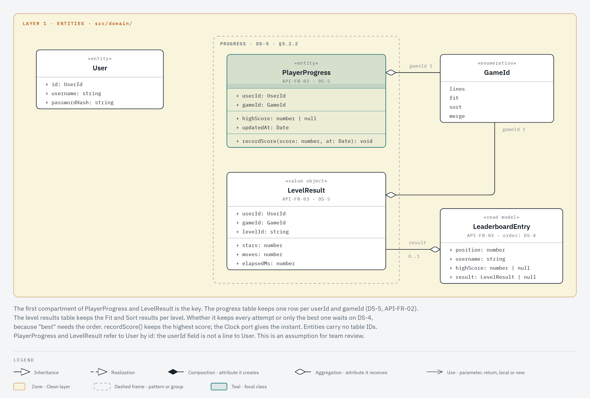
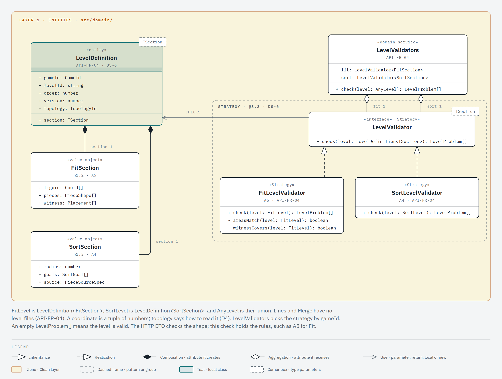
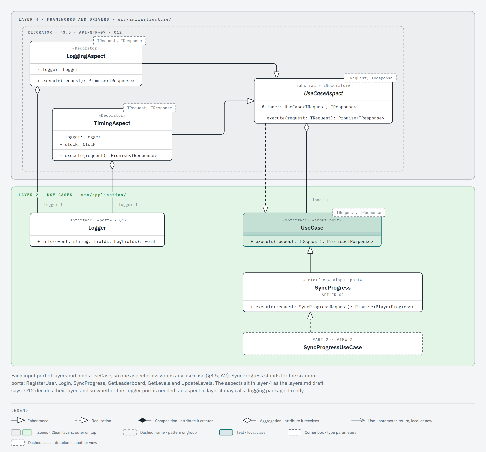
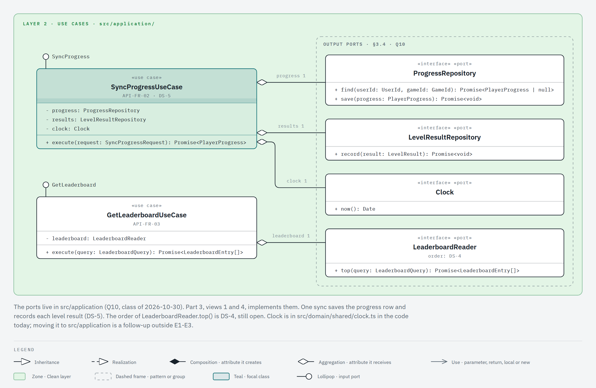
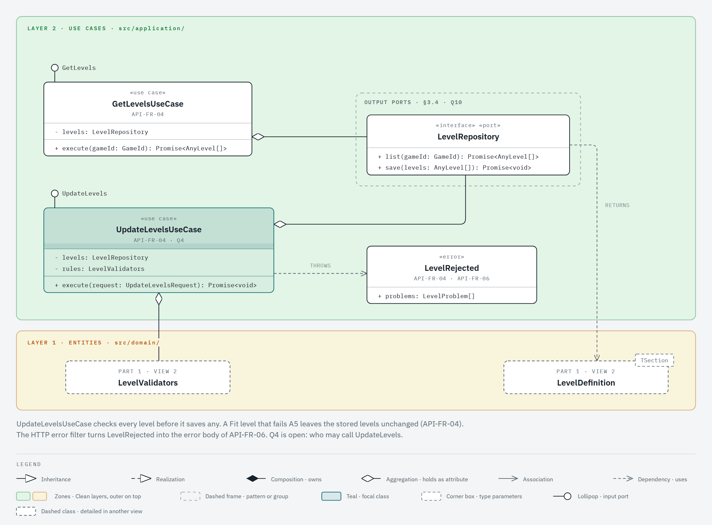
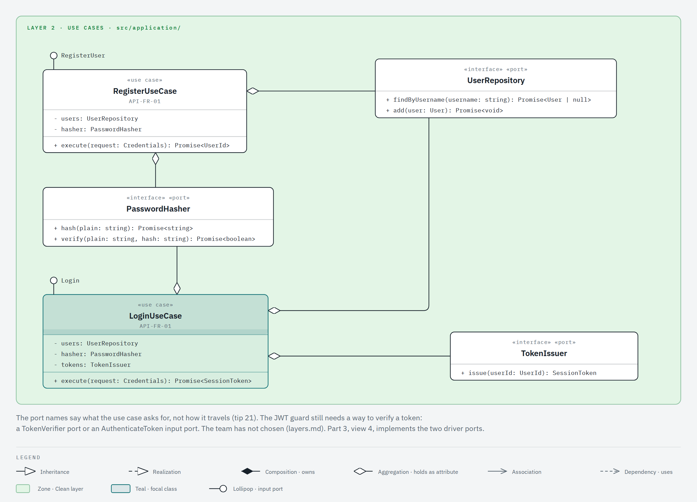
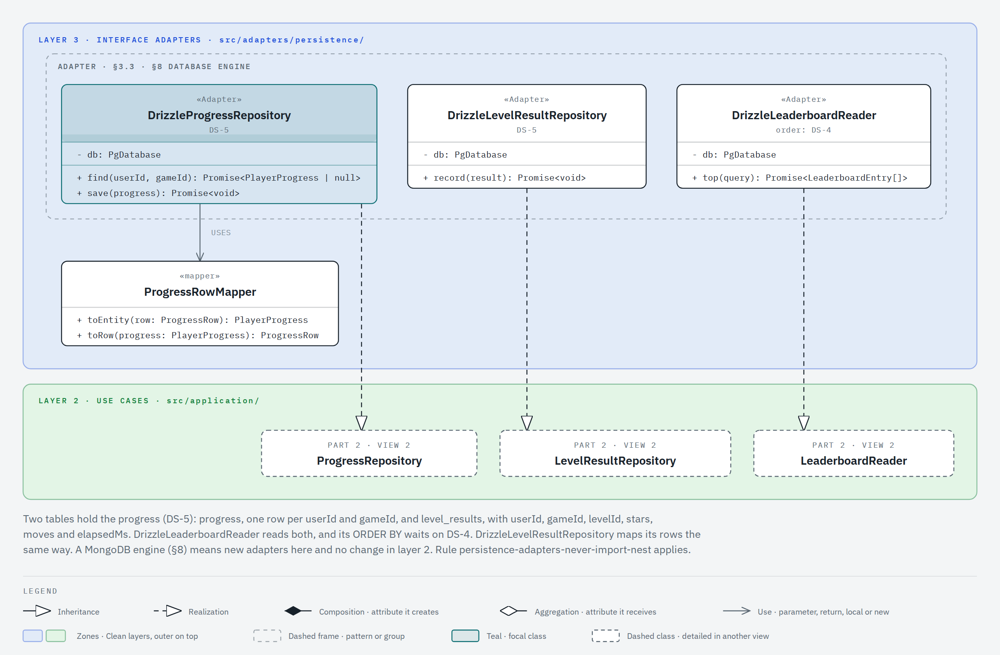
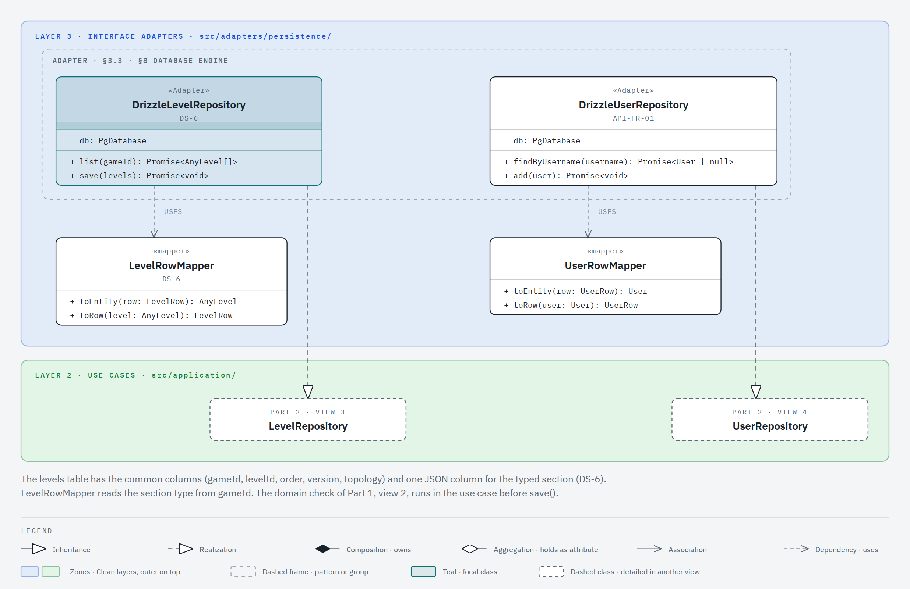
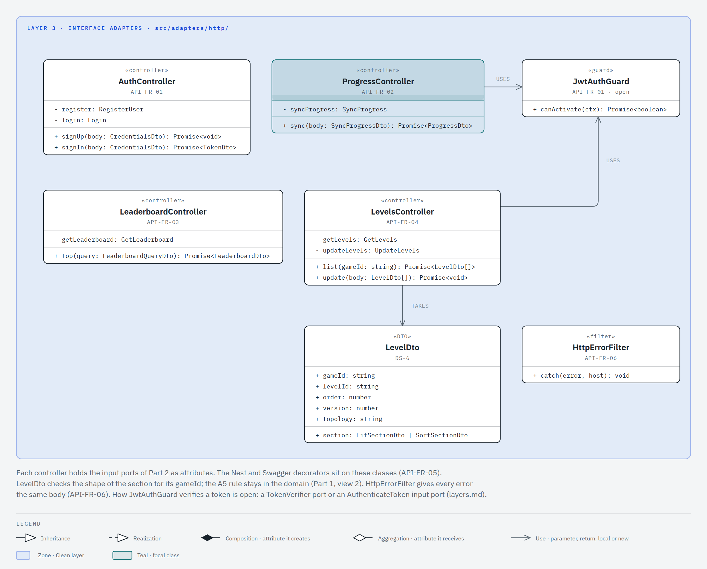
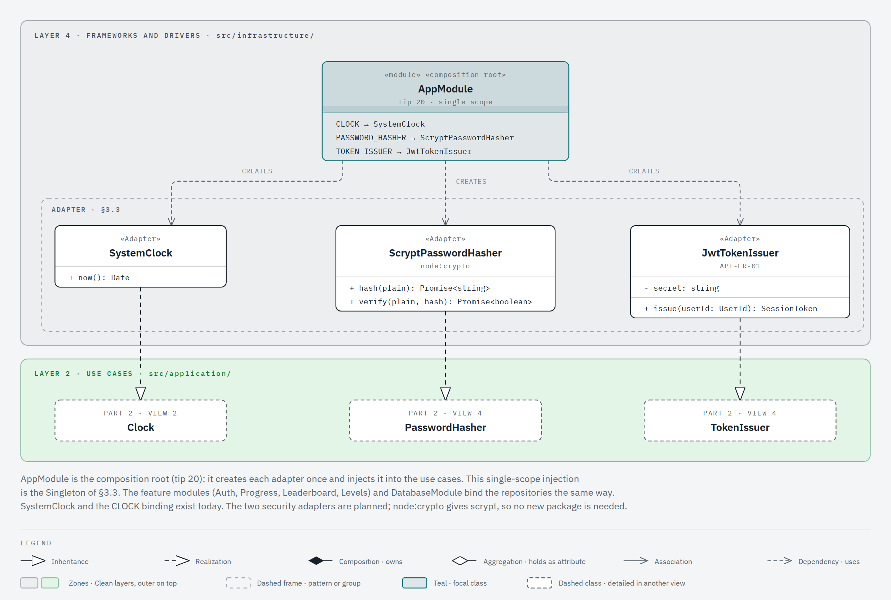

# Class diagram

Status: draft for team review, 2026-10-31. Part 1 covers layer 1: the progress entities and the level schema. Part 2 covers layer 2: the use cases and their ports. Part 3 covers layers 3 and 4: the adapters and the drivers.

This page answers statement §4.1 for the API, as decision D6 asks (it replaces assumption A9). It shows the generic types in UML template notation, the layer of each class, and the design patterns. Each view shows at most seven classes and eight relationships. IDs such as A5, D6 and Q10 refer to [`docs/REQUIREMENTS.md`](../REQUIREMENTS.md). DS-4, DS-5 and DS-6 are the data shape decisions of its §4. The layers themselves are in [layers.md](layers.md). The extension points are in [extensibility.md](extensibility.md).

## How to read it

- The colored zone is the Clean layer, with the colors of [layers.md](layers.md).
- One view can show several layers. The zones are bands, with the outer layer at the top and the inner layer at the bottom, so every dependency between layers points down.
- A dashed frame groups the classes of one GoF pattern or one group. Its label names the source, for example `STRATEGY · §3.3 · DS-6`.
- A stereotype such as `«Strategy»` marks the role of one class in that pattern. `«port»` marks an interface that an outer layer implements.
- The dashed box at the top right of a class holds its type parameters. This is the UML template notation that §4.1 asks for.
- The teal class is the focal class of the view.
- A lollipop (a circle on a short line) is the input port that a use case implements.
- A dashed class with no members is a class that another view details. Its eyebrow names that view, for example `PART 2 · VIEW 2`.
- Under the name of a class, an ID such as `API-FR-04` names the requirement it serves.
- A class that keeps another class in an attribute draws a diamond at its own end: hollow (aggregation) when the value comes from outside, filled (composition) when the class creates it. The other end names the attribute and its multiplicity, even when it is 1. A solid line with an open arrowhead and a verb is a use: the other class is only a parameter, a return value, a local variable or a `new`. This follows the course (board of the class of 2026-10-02; tip 23 of 2026-10-30).
- Every class is planned, except `Clock`, `SystemClock` and `AppModule`. Today `src/` holds the health endpoint, the `Clock` port and its adapter, and the database connection.

## Part 1: the domain

`src/domain/`, layer 1. It imports nothing outside `src/domain/` (rule `domain-imports-only-domain`).

### View 1.1: progress and level results

### View 1.2: the level schema

## Part 2: the use cases

`src/application/`, layer 2. It imports only `src/domain/` and `src/application/` (rule `application-imports-only-domain`). The ports live here (Q10).

### View 2.1: the use case contract and its aspects

### View 2.2: progress and leaderboard

### View 2.3: levels

### View 2.4: account

## Part 3: adapters and drivers

Layer 3, `src/adapters/`, and layer 4, `src/infrastructure/`. Adapters never import `src/infrastructure/` (rule `adapters-never-import-infrastructure`). The persistence adapters never import Nest (rule `persistence-adapters-never-import-nest`).

### View 3.1: progress store

### View 3.2: level and user store

### View 3.3: HTTP

### View 3.4: wiring

## Data shapes

The team closed two data shape decisions on 2026-10-30. The app draws the same names on its side.

**DS-5: two tables for progress** (option «B · Dos tablas»). It serves API-FR-02 and API-FR-03.

| Table           | Key                           | Other columns                 | Read by                                   |
| --------------- | ----------------------------- | ----------------------------- | ----------------------------------------- |
| `progress`      | `userId`, `gameId`            | `highScore`, `updatedAt`      | sync, global leaderboard per `gameId`     |
| `level_results` | `userId`, `gameId`, `levelId` | `stars`, `moves`, `elapsedMs` | sync, per-level leaderboard for Fit, Sort |

**DS-6: one level schema, a common part and a typed section** (option «A · Común + sección tipada»). It serves API-FR-04.

| Part         | Fields                                              | Checked by                                   |
| ------------ | --------------------------------------------------- | -------------------------------------------- |
| Common       | `gameId`, `levelId`, `order`, `version`, `topology` | `LevelDto` (shape)                           |
| Fit section  | `figure`, `pieces`, `witness`                       | `LevelDto` (shape), `FitLevelValidator` (A5) |
| Sort section | `radius`, `goals`, `source`                         | `LevelDto` (shape), `SortLevelValidator`     |

The API rejects a Fit level that fails A5: the piece areas differ from the figure area, or the witness does not cover the figure exactly. `UpdateLevelsUseCase` checks every level before it saves any level.

**DS-4 stays open.** It decides what orders the per-level leaderboard (stars, moves, time) for Fit and Sort. `LeaderboardReader` and its Drizzle adapter wait on it.

## Patterns

D7 asks for a written reason for each pattern. The Reason column names the requirement behind it. In the Views column, `2.1` is view 1 of part 2.

| Pattern                            | Classes                                                                           | Reason                                                                                                                      | Views         |
| ---------------------------------- | --------------------------------------------------------------------------------- | --------------------------------------------------------------------------------------------------------------------------- | ------------- |
| Strategy                           | `LevelValidator`, `FitLevelValidator`, `SortLevelValidator`                       | Mandatory (§3.3). Each `gameId` with levels checks its section with its own rules (DS-6, API-FR-04, A5).                    | 1.2           |
| Decorator                          | `UseCaseAspect`, `LoggingAspect`, `TimingAspect`                                  | The aspects of §3.5 wrap any use case and add no code to it (API-NFR-07, A2). Q12 decides their layer.                      | 2.1           |
| Adapter                            | The Drizzle repositories; `SystemClock`, `ScryptPasswordHasher`, `JwtTokenIssuer` | A new database engine means new adapters, and the use cases do not change (§3.3, §3.4, the database engine row of §8).      | 3.1, 3.2, 3.4 |
| Singleton (single-scope injection) | `AppModule` and its providers                                                     | One instance of each adapter for the whole API (§3.3: «Singleton (o inyección de dependencias con alcance único)»; tip 20). | 3.4           |

Abstract Factory is also mandatory in §3.3. The app holds it: one factory per variant. The API does not use it. See decision 8.

## Why each abstraction exists

Every abstraction cites a requirement, a declared variation or a layer boundary. A class with no citation stays a plain class.

| Abstraction                                    | Reason                                                                                                                  |
| ---------------------------------------------- | ----------------------------------------------------------------------------------------------------------------------- |
| `UseCase<TRequest, TResponse>` and input ports | Layer boundary: the controllers depend on the interface (layers.md). One aspect wraps any use case (§3.5).              |
| Output ports (`ProgressRepository` and others) | Layer boundary (§3.4, Q10). The database engine row of §8.                                                              |
| `PasswordHasher`, `TokenIssuer`, `Clock`       | Layer boundary: the use cases do not read the system clock or a crypto library (API-NFR-11, rule R-deterministic-core). |
| `Logger`                                       | Layer boundary, only when the aspects live in `src/application` (Q12).                                                  |
| `LevelDefinition<TSection>`                    | DS-6: one schema with a typed section per `gameId`. Generics are required (D6).                                         |
| `LevelValidator<TSection>`                     | DS-6: each variant validates its own section. A5 for Fit (API-FR-04).                                                   |

Plain classes: `LevelValidators`, the row mappers, `LeaderboardEntry`, `LevelRejected`, the controllers, `LevelDto`, the guard and the filter.

## Decisions to check with the team

1. **Ports in the application layer.** The class of 2026-10-30 answered Q10: «Los puertos están en la capa de aplicación.» [26:41] (tip 21). Every port in this diagram is in `src/application/`. The code still has `Clock` in `src/domain/shared/clock.ts`. Moving it is a follow-up outside E1-E3.
2. **Two progress tables (DS-5).** `progress` keeps one row per `userId` and `gameId`. `level_results` keeps `userId`, `gameId`, `levelId`, `stars`, `moves` and `elapsedMs`. Whether `level_results` keeps every attempt or only the best one waits on DS-4, because "best" needs the order.
3. **The progress row fields (proposal).** DS-5 fixes the key. `highScore` and `updatedAt` are our proposal: the app keeps a high score for Lines and Merge, and the Clock port gives the instant.
4. **One generic level type (DS-6).** `LevelDefinition<TSection>` holds the common part, and `TSection` is `FitSection` or `SortSection`. `LevelDto` checks the shape in layer 3. `FitLevelValidator` checks A5 in layer 1. Lines and Merge have no level files (API-FR-04).
5. **`LevelValidators` chooses by `gameId`.** It is a plain class with one field per variant that has levels. A new variant with levels adds one field and one strategy.
6. **Coordinates as tuples, topology as a field.** A coordinate is a tuple of numbers, and `topology` says how to read it. So a square, triangular or 3D level (§8, D4) needs no new schema. The A5 check rotates pieces, and the rotation step depends on the topology. Today only the hexagonal topology exists. When a second topology reaches the level files, the Fit check needs a topology strategy (D5).
7. **One generic input port.** Every input port of [layers.md](layers.md) binds `UseCase<TRequest, TResponse>`, for example `SyncProgress`. One aspect class then wraps any use case (§3.5). The app makes the same choice (its decision 9). The cost: an input port cannot add a second method.
8. **No Abstract Factory in the API.** In the API, a variant has one product: its level validator. A factory per variant would wrap one constructor. To check with the team: whether the professor expects the pattern in the backend too.
9. **Port names in the language of the game.** A port says what the use case asks for, not how the data travels. For example, `LeaderboardReader`, not a name that says SQL or HTTP. This follows the class of 2026-10-30 on structural coupling [46:52] (tip 21).
10. **Aspects in layer 4 for now.** The aspects sit in `src/infrastructure/`, as the [layers.md](layers.md) draft says. Q12 can move them to `src/application/`. Then the `Logger` port stays. Otherwise an aspect may call a logging package directly.

## Render the images

The views come from the HTML files in [`classes/views/`](classes/views/). Each file holds one inline SVG drawn with the diagram-design skill and the HexaBlock profile. Open the file in a browser to see the drawing. The `.png` image next to it is that SVG rendered at scale 2 by a headless browser. After you edit a file, export the image again with `/diagram-design:export-diagram docs/architecture/classes/views/<view>.html --png-only`, then run `pnpm format`. The formatter changes the HTML layout only; the drawing stays the same. Commit each `.html` file together with its `.png` image.
