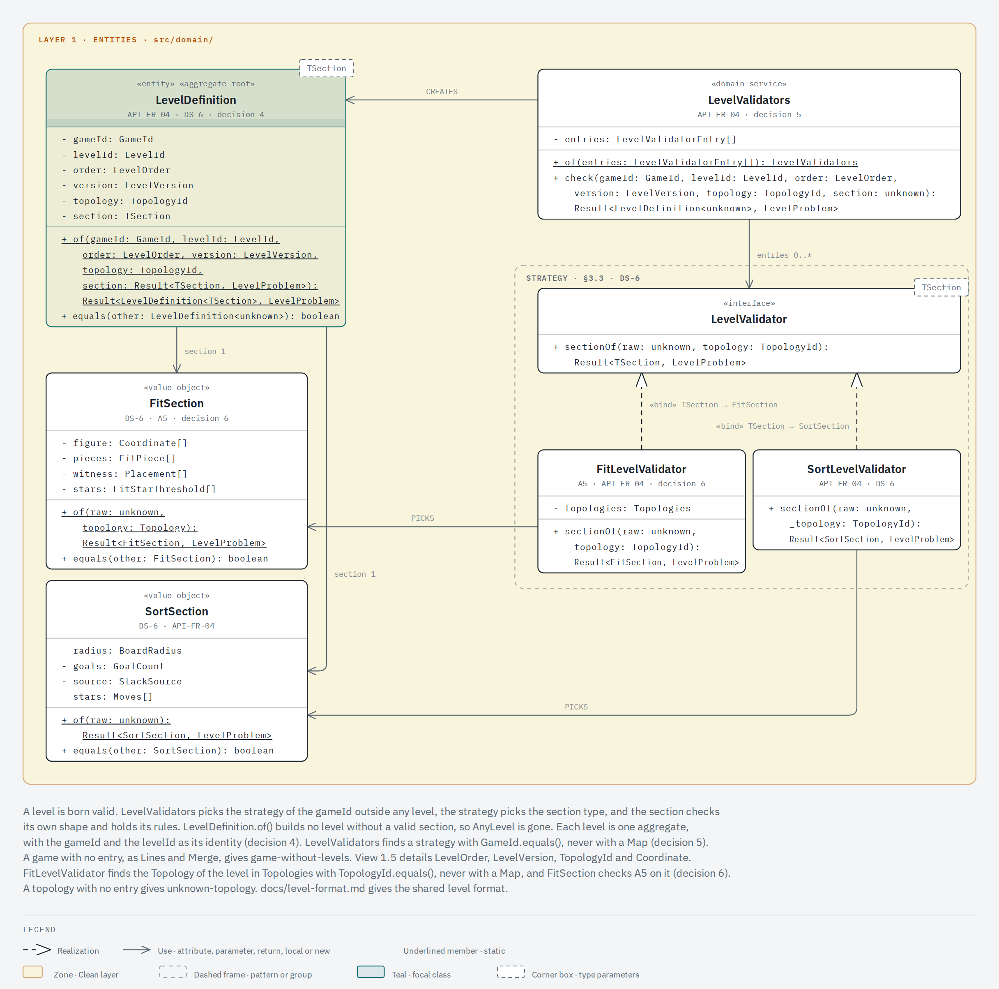
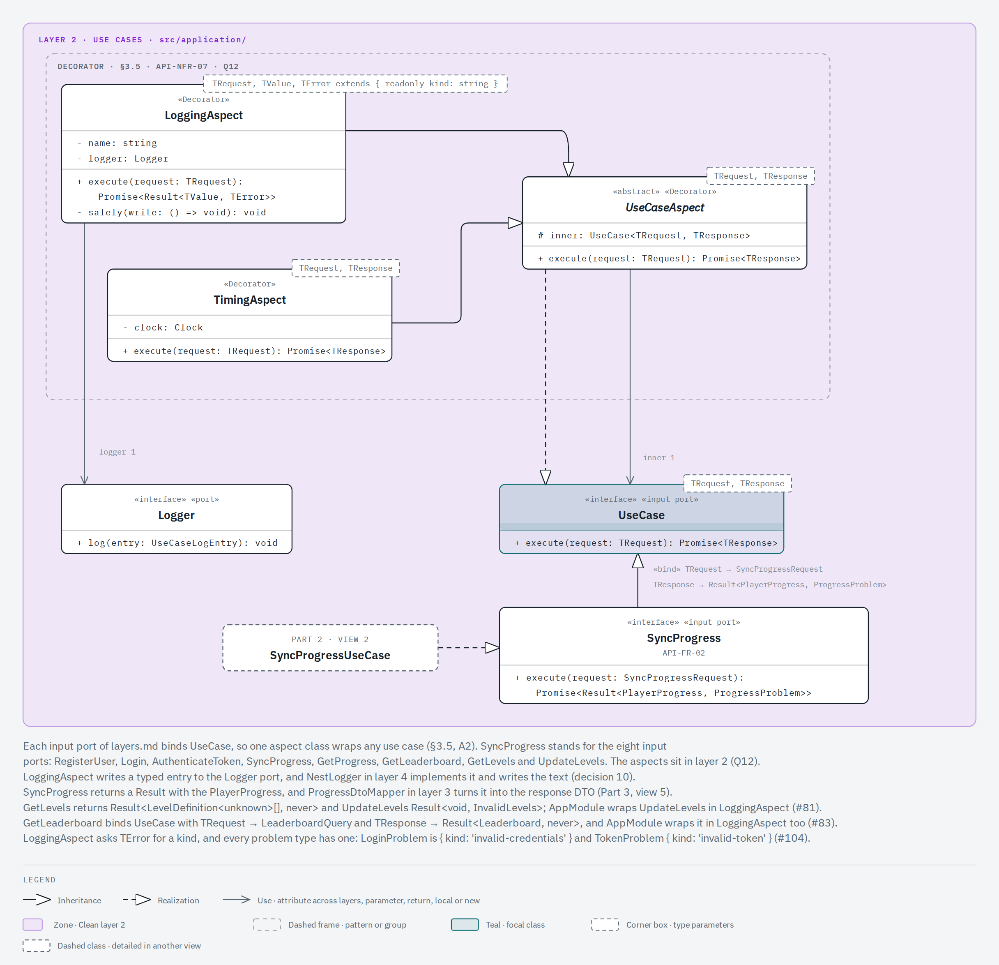
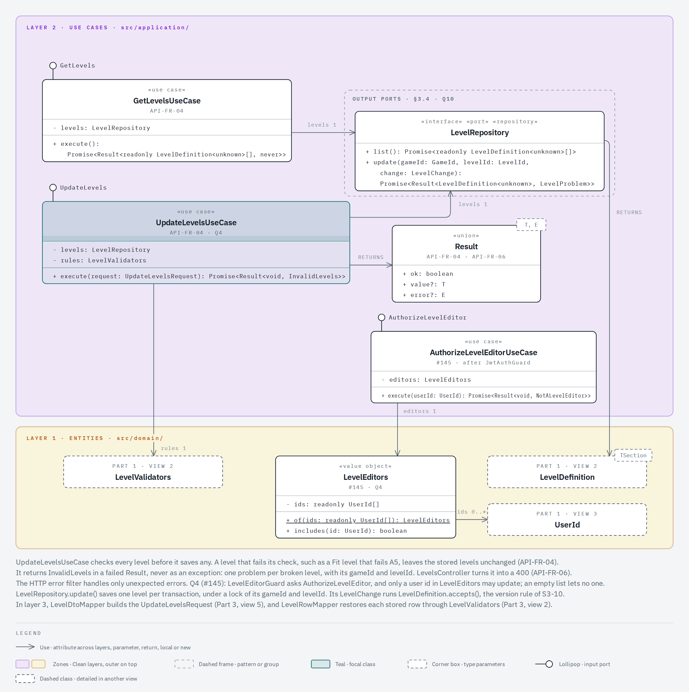
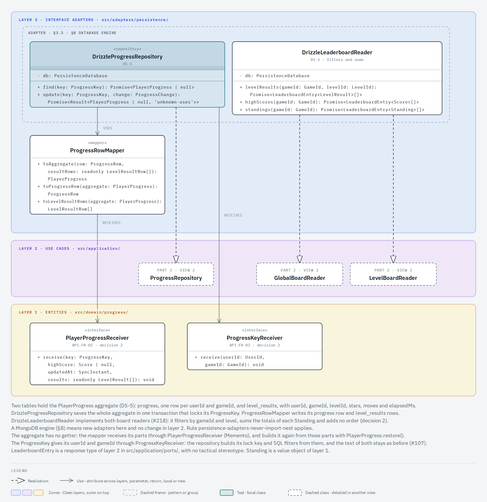
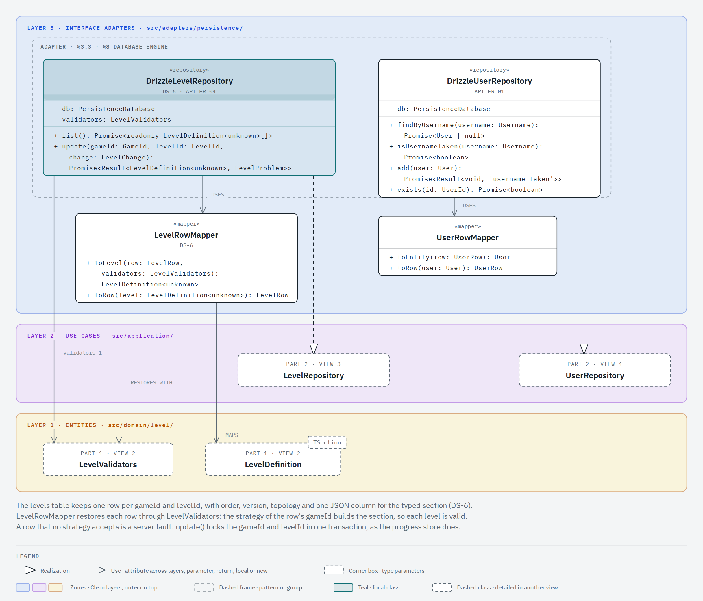
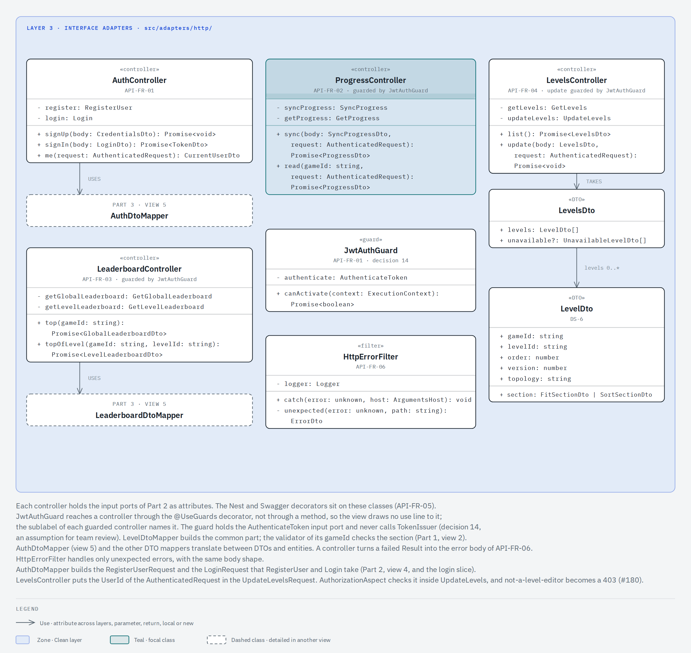
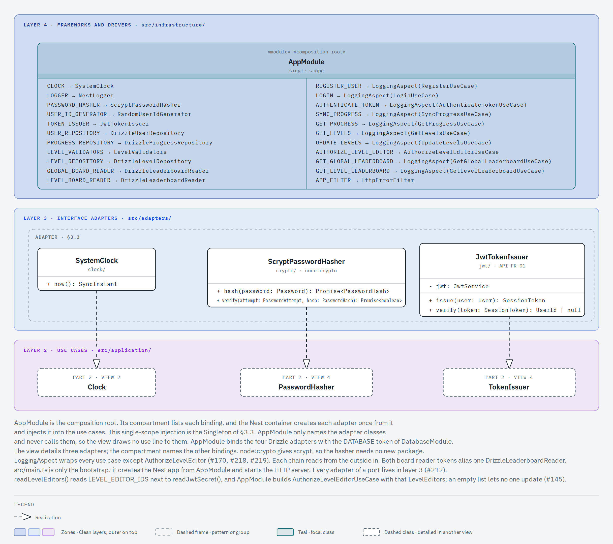
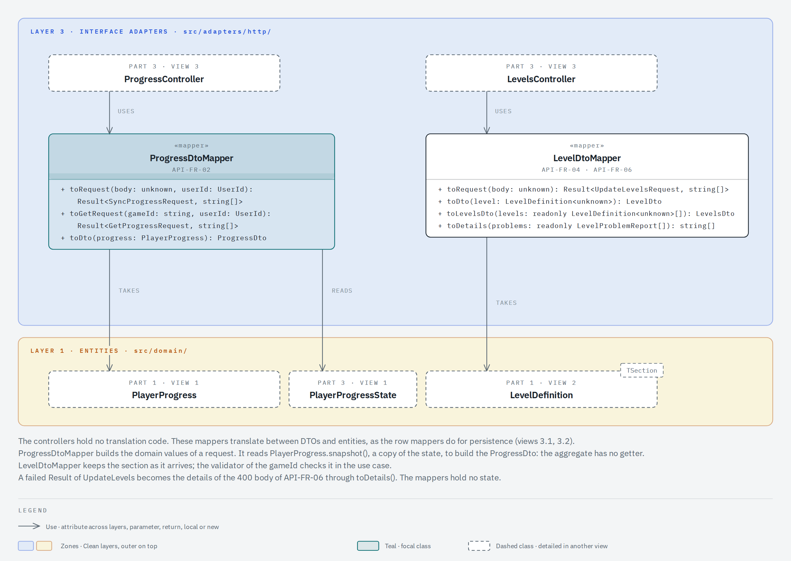

# Class diagram

Status: draft for team review, 2026-10-31. Part 1 covers layer 1: the progress entities and the level schema. Part 2 covers layer 2: the use cases and their ports. Part 3 covers layers 3 and 4: the adapters and the drivers.

This page answers statement §4.1 for the API, as decision D6 asks (it replaces assumption A9). It shows the generic types in UML template notation, the layer of each class, and the design patterns. Each view shows at most seven classes and eight relationships. IDs such as A5, D6 and Q10 refer to [`docs/REQUIREMENTS.md`](../REQUIREMENTS.md). DS-4, DS-5 and DS-6 are the data shape decisions of its §4. The layers themselves are in [layers.md](layers.md). The extension points are in [extensibility.md](extensibility.md). The use case flows are in [flows.md](flows.md).

## Whole model in draw.io

[`classes.drawio`](classes.drawio) holds the whole class model in one draw.io file, with 4 pages. Open it in draw.io or diagrams.net.

- Page 1, `All classes`, holds every class, interface and type of the model once, by layer: layer 4 at the top and layer 1 at the bottom, so every dependency points down.
- Pages 2 to 4, `Domain`, `Use cases` and `Adapters`, hold one part each. A part page shows the types of its part in full. A grey box with the name only is a type of another part that one of its lines touches, and its eyebrow names the page that details it.
- A solid box is a type that exists in the code at `3a3b45a`. A dashed box with `«planned»` is design from the views of this page that the code does not have yet. It keeps the `«Sprint N»` of its view when the view gives one.
- `members not designed yet` marks a planned class that no view details.
- `«dataType»` marks a type in the code that only carries data; it has no operations by design. `«module»` marks `AppModule`, a Nest module that only holds decorator metadata.
- The pages follow the reading rules of the next section, and each page has a legend.

The file is generated from the code at `3a3b45a` plus the views of this page. A hand edit is lost at the next generation.

## How to read it

- The colored zone is the Clean layer, with the colors of [layers.md](layers.md): yellow for layer 1, purple for layer 2, light blue for layer 3 and dark blue for layer 4.
- One view can show several layers. The zones are bands, with the outer layer at the top and the inner layer at the bottom, so every dependency between layers points down.
- A dashed frame groups the classes of one GoF pattern or one group. Its label names the source, for example `STRATEGY · §3.3 · DS-6`. A frame is not a class. No line starts or ends on a frame. When two classes of different groups depend on each other, the line joins those two classes. A line from one frame to another frame would claim that every class of the first group uses every class of the second group, and that is usually false. The professor asked this about a frame-to-frame arrow in the session of 2026-11-03: «todas esas usan los tres bloques de abajo, a lo mejor la respuesta es no».
- The interface of a GoF pattern carries only `«interface»`, and the concrete classes of the pattern carry no role label and no tactical stereotype, as the professor draws them (class of 2026-11-14; design decision of 2026-11-15). The dashed frame of the pattern, or a note, names the pattern. Views that still show a role label, such as `«Strategy»` or `«Decorator»`, lose it when they are drawn again. `«port»` marks an interface that an outer layer implements. `«repository»` marks a repository: the port in layer 2 and its adapter in layer 3. A domain class carries its tactical stereotype: `«entity»`, `«aggregate root»`, `«value object»` or `«domain service»`.
- An underlined member is static, as in UML.
- The dashed box at the top right of a class holds its type parameters. This is the UML template notation that §4.1 asks for.
- A `«bind»` label on a realization or an inheritance line names the type that each parameter takes, for example `«bind» TSection → FitSection`.
- The teal class is the focal class of the view.
- A lollipop (a circle on a short line) is the input port that a use case implements.
- A dashed class with no members is a class that another view details. Its eyebrow names that view, for example `PART 2 · VIEW 2`.
- Under the name of a class, an ID such as `API-FR-04` names the requirement it serves.
- A filled diamond (composition) joins the root of an aggregate to each of its internal entities, on the side of the root. An internal entity exists only inside its aggregate, and only the root creates and changes it. The other end names the attribute and its multiplicity, even when it is 1. Any other attribute is a use arrow with the same role and multiplicity: a value object, the strategy of a context, the object that a decorator wraps, and a port. For example, `PlayerProgress` keeps its `LevelResult` values, and `LevelDefinition` holds its section, through use arrows. No hollow diamond appears. This follows the drawings of the classes of 2026-11-13 and 2026-11-14 (decision 13).
- A solid line with an open arrowhead is a use: the class depends on the other class. It points from the class that holds or calls to the class it needs. When the other class is an attribute that is not an internal entity, or an attribute across layers, the label names the attribute and its multiplicity. A port counts as across layers: it lives in layer 2, and its adapter lives in layer 3 or 4. When the other class is only a parameter, a return value, a local variable or a `new`, the label is a verb. A link that is none of these, such as a guard that a decorator applies or a class that a module only names in its metadata, gets no line; the box or the note names it. This follows the class of 2026-11-02 (decision 13), which replaces the diamond rule of the board of the class of 2026-10-02.
- The legend of each view lists only the line kinds that the view draws.
- The views do not mark which classes are planned. Today `src/` holds the user and progress classes of the domain with `Standing` and `LevelsCompleted`, the account and progress use cases with their ports, the `LeaderboardReader` port with `LeaderboardEntry`, `GetLeaderboardUseCase`, `LeaderboardController` with `LeaderboardDtoMapper`, their adapters, `LoggingAspect` and `AppModule`. The level classes and `TimingAspect` are planned.

## Part 1: the domain

`src/domain/`, layer 1. It imports nothing outside `src/domain/` (rule `domain-imports-only-domain`).

### View 1.1: progress and level results

![Progress: the PlayerProgress aggregate root per userId and gameId, which holds a UserId and a GameId, keeps its high score as a Score value object, delivers its parts to a PlayerProgressReceiver with deliverTo(), is built again by restore() and keeps its LevelResult values; the Standing value object, which holds the totals and the global order of Fit and Sort; and, in layer 2, the LeaderboardEntry response type, which names the player by UserId and holds the LevelResult, the Score or the Standing that ranks the player](classes/views/domain-1-progress.png)

### View 1.2: the level schema

### View 1.3: the user and its credential values

### View 1.4: the level result and its values

## Part 2: the use cases

`src/application/`, layer 2. It imports only `src/domain/` and `src/application/` (rule `application-imports-only-domain`). The ports live here (Q10).

### View 2.1: the use case contract and its aspects

### View 2.2: progress and leaderboard

### View 2.3: levels

### View 2.4: account

## Part 3: adapters and drivers

Layer 3, `src/adapters/`, and layer 4, `src/infrastructure/`. Adapters never import `src/infrastructure/` (rule `adapters-never-import-infrastructure`). The persistence adapters never import Nest (rule `persistence-adapters-never-import-nest`).

### View 3.1: progress store

### View 3.2: level and user store

### View 3.3: HTTP

### View 3.4: wiring

### View 3.5: HTTP mappers

## Use case slices

One use case can cross every layer. [flows.md](flows.md) follows one request through the layers for each path that shows something new: a class view of that use case only, and a UML sequence diagram with the same class names. Its table «Other use cases» names the path that each other use case follows.

### Slice 1: sync progress

### Slice 2: login

### Slice 3: update levels

## Data shapes

The team closed two data shape decisions on 2026-10-30. The app draws the same names on its side.

**DS-5: two tables for progress** (option «B · Dos tablas»). It serves API-FR-02 and API-FR-03.

| Table           | Key                           | Other columns                 | Read by                                   |
| --------------- | ----------------------------- | ----------------------------- | ----------------------------------------- |
| `progress`      | `userId`, `gameId`            | `highScore`, `updatedAt`      | sync, global leaderboard per `gameId`     |
| `level_results` | `userId`, `gameId`, `levelId` | `stars`, `moves`, `elapsedMs` | sync, per-level leaderboard for Fit, Sort |

**DS-6: one level schema, a common part and a typed section** (option «A · Común + sección tipada»). It serves API-FR-04.

| Part         | Fields                                              | Checked by                         |
| ------------ | --------------------------------------------------- | ---------------------------------- |
| Common       | `gameId`, `levelId`, `order`, `version`, `topology` | `LevelDto` (shape)                 |
| Fit section  | `figure`, `pieces`, `witness`, `stars`              | `FitLevelValidator` (shape and A5) |
| Sort section | `radius`, `goals`, `source`, `stars`                | `SortLevelValidator` (shape)       |

The Fit `stars` field is a list of `FitStarThreshold`, each one a `maxMoves` count and a `maxElapsedMs` time, and a Fit star needs both ([hexablock-app#60](https://github.com/Hexablock-Suite/hexablock-app/issues/60), 2026-11-06). The Sort `stars` field is a list of `SortStarThreshold`, each one a `maxMoves` count (stars by moves, [hexablock-app#59](https://github.com/Hexablock-Suite/hexablock-app/issues/59), 2026-11-06). In both sections the stars are cumulative: star N needs star N-1.

The API rejects a Fit level that fails A5: the piece areas differ from the figure area, or the witness does not cover the figure exactly. `UpdateLevelsUseCase` checks every level before it saves any level.

**DS-4 is closed** (2026-11-06, [#24](https://github.com/Hexablock-Suite/hexablock-api/issues/24)). The best result of a level has more stars; on equal stars, fewer moves; on equal moves, less time. On a full tie, the stored result stays. `LevelResult.isBetterThan()` holds this order: it asks `Stars.isMoreThan()`, then `Moves.isFewerThan()`, then `ElapsedTime.isShorterThan()`. `PlayerProgress.recordLevel()` keeps the best result of each level (DS-12). The same order ranks the per-level leaderboard of Fit and Sort. The global leaderboard of Lines and Merge ranks by `Score.isHigherThan()`. The global leaderboard of Fit and Sort ranks by `Standing.isBetterThan()`: more total stars, then more levels completed, then fewer total moves, then less total time (S3-03, a proposal that the team confirms on [#76](https://github.com/Hexablock-Suite/hexablock-api/issues/76)). `LeaderboardReader` only filters and sums, and `GetLeaderboardUseCase` orders the entries with these comparisons (decision 2).

## Patterns

D7 asks for a written reason for each pattern. The Reason column names the requirement behind it. In the Views column, `2.1` is view 1 of part 2.

| Pattern                            | Classes                                                                           | Reason                                                                                                                 | Views              |
| ---------------------------------- | --------------------------------------------------------------------------------- | ---------------------------------------------------------------------------------------------------------------------- | ------------------ |
| Strategy                           | `LevelValidator`, `FitLevelValidator`, `SortLevelValidator`                       | Mandatory (§3.3). Each `gameId` with levels registers the validator that checks its section (DS-6, API-FR-04, A5).     | 1.2                |
| Decorator                          | `UseCaseAspect`, `LoggingAspect`, `TimingAspect`                                  | The aspects of §3.5 wrap any use case and add no code to it (API-NFR-07, A2). Q12 put them in layer 2.                 | 2.1                |
| Adapter                            | The Drizzle repositories; `SystemClock`, `ScryptPasswordHasher`, `JwtTokenIssuer` | A new database engine means new adapters, and the use cases do not change (§3.3, §3.4, the database engine row of §8). | 3.1, 3.2, 3.4      |
| Singleton (single-scope injection) | `AppModule` and its providers                                                     | One instance of each adapter for the whole API (§3.3: «Singleton (o inyección de dependencias con alcance único)»).    | 3.4                |
| Memento                            | `PlayerProgress`, `User` and their receivers                                      | The aggregate has no getter: it delivers its parts to the border, and `restore()` builds it again (decisions 2, 16).   | 1.1, 1.3, 3.1, 3.5 |

Abstract Factory is also mandatory in §3.3. The app holds it: one factory per variant. The API does not use it. See decision 8.

## Why each abstraction exists

Every abstraction cites a requirement, a declared variation or a layer boundary. A class with no citation stays a plain class.

| Abstraction                                    | Reason                                                                                                                  |
| ---------------------------------------------- | ----------------------------------------------------------------------------------------------------------------------- |
| `UseCase<TRequest, TResponse>` and input ports | Layer boundary: the controllers depend on the interface (layers.md). One aspect wraps any use case (§3.5).              |
| Output ports (`ProgressRepository` and others) | Layer boundary (§3.4, Q10). The database engine row of §8.                                                              |
| `PasswordHasher`, `TokenIssuer`, `Clock`       | Layer boundary: the use cases do not read the system clock or a crypto library (API-NFR-11, rule R-deterministic-core). |
| `Result<T, E>`                                 | A use case returns an expected failure as a value. No exception crosses the input port to the HTTP layer.               |
| `LevelDefinition<TSection>`                    | DS-6: one schema with a typed section per `gameId`. Generics are required (D6).                                         |
| `LevelValidator<TSection>`                     | DS-6: each variant validates its own section. A5 for Fit (API-FR-04).                                                   |
| `Range<T>`                                     | Credential limits (#60): `Username`, `Password`, the HTTP messages and `CredentialsDto` use one range (D6).             |

Plain classes: `LevelValidators`, the row mappers, the HTTP mappers, the controllers, `LevelDto`, the guard and the filter. `LeaderboardEntry<TResult>` is a response type of layer 2 in `src/application/ports/`, with no tactical stereotype. It holds the `UserId` of the player and the domain value that ranks the player: a `LevelResult`, a `Score` or a `Standing`. It has no rule of its own, because the order of each board lives in that value object of the domain (decision 2). `PlayerProgressReceiver<TInstant>` and `UserReceiver` are receiver interfaces of the domain with no tactical stereotype: each aggregate delivers its parts to one of them, as a value object delivers its datum, and only the border implements them (decisions 2, 15 and 16). Through them each aggregate gives its state to the border, as the Memento of decision 2 asks. `ProgressValues` and `UserValues` in `src/adapters/received.ts` hold the plain values that the border receives; they are types of the border, not of the domain. `LevelValidators` is a registry: the composition root fills it, so it needs no interface of its own.

## Domain design rules

These rules say how the domain model must be. They apply to every class of `src/domain/`, built or planned, and to the class views that draw it. They come from the classes of 2026-11-13 and 2026-11-14 and from the design decisions of the team of 2026-11-15. When the code does not follow a rule yet, the code changes, not the rule. Rule R-domain-design of `AGENTS.md` points to this section.

### Aggregates

- **The root is the only door.** Code outside an aggregate sends every message to its root. No public method of the root returns an internal entity or another aggregate. Only data in domain types leaves the aggregate, never a part that the caller can change (classes of 2026-11-13 and 2026-11-14).
- **Invariants hold after each operation.** When an operation on the aggregate ends, every invariant of the aggregate holds. The boundary of the aggregate encloses the true invariants of the business (class of 2026-11-13).
- **Global identity only in the root.** The system identifies the root of an aggregate in one universal way. An internal entity has a local identity: it has a meaning only inside its aggregate (class of 2026-11-13). The factory of the aggregate builds that local id from the identity of the root, and it asks no id generator for it (design decision of 2026-11-15).
- **One repository per aggregate.** Each aggregate has its repository in the design, also when its adapter keeps the data in memory. The port carries the name of the aggregate, and it saves and finds the whole root with its parts. No repository exists for an internal entity or for another part of an aggregate (classes of 2026-11-13 and 2026-11-14).
- **One aggregate per transaction.** A transaction changes one aggregate. A use case can read many aggregates, but each transaction changes only one of them. Outside the boundary of an aggregate, the system accepts eventual consistency. If one operation must change two aggregates at the same time, the boundary is wrong (classes of 2026-11-13 and 2026-11-14). When one request changes several aggregates, the use case checks all of them first. Then it saves each aggregate in its own transaction (design decision of 2026-11-15).
- **Reference by identity.** An aggregate refers to another aggregate only by the identity that the system gives to the other root. It never holds the other aggregate, and it never refers to it by a business key that can change, such as a username. If an aggregate needs data of another aggregate, it keeps a local view with only that data. That view can be out of date for a short time (class of 2026-11-13).
- **Events, not questions.** An aggregate never asks another aggregate for data. It tells its changes through domain events, and each listener reacts. The root only records its events. A use case delivers them after the change (class of 2026-11-13; design decision of 2026-11-15).
- **Small aggregates.** An aggregate holds the true invariants of the business and no more, so it stays small. A value object is never the root of an aggregate. Two concepts that the business defines separately never share one aggregate (class of 2026-11-13).

### Domain services

- A domain service is a business operation of the domain layer that does not belong to an entity, a value object or an aggregate (class of 2026-11-13).
- First, try to put the operation in an aggregate. The operation does not go there if it must load other aggregates or create objects of another aggregate. It is a domain service only when no aggregate can hold it (class of 2026-11-13).
- A domain service has no state. It has one public method, which takes and returns domain objects. Private methods can help it (class of 2026-11-13).
- Its name and the name of its method use verbs of the language of the game. A name such as `ProgressHelper` or `LevelManager` is wrong (class of 2026-11-13).
- It receives entities and value objects that are already loaded, applies the rule and returns a result. It never calls a repository, it opens no transaction, and it never touches the infrastructure (classes of 2026-11-13 and 2026-11-14).
- The rules of each aggregate stay inside the aggregate. A domain service only coordinates what no aggregate can do alone (class of 2026-11-13).
- A use case is an application service, not a domain service. It loads the aggregates through their repositories, asks the domain, and saves the one aggregate that changed (classes of 2026-11-13 and 2026-11-14).

### Values, time, orders and names

- **Value objects are immutable.** A value object keeps each field private and `readonly`, it has no setter, and an operation that gives a different value returns a new value object (class of 2026-11-14).
- **One failure mechanism.** The factory of every value object returns a `Result`: a datum that breaks the rule gives a failed `Result`, never an exception (design decision of 2026-11-15). The failure carries a code for the broken rule, and the border writes the message. Only a guard against a programming defect, such as a missing argument, can still throw. This is the mechanism of decision 11.
- **The border builds the domain values.** An adapter of layer 3, such as a DTO mapper, builds the domain values from the request. A use case receives domain values, and it never builds a domain value from a loose primitive (design decision of 2026-11-15). This extends decision 12 to every use case.
- **Time is a value object.** The domain model holds no `Date`: no field, parameter or return value in `src/domain/` is a `Date` (class of 2026-11-14). The value object of a time takes its name from the language of the game, for example the instant of a sync. Each time concept with a different meaning has its own value object. A general name, such as `Instant`, is correct only when the domain has one meaning of time (design decision of 2026-11-15).
- **Each ranking order lives in the domain.** An order that ranks domain objects, such as the order of a leaderboard, lives in one value object of the domain, which compares two of them. A reader port only filters and sums. The use case orders with the comparisons of the domain, and the adapter adds no order (design decision of 2026-11-15). This applies the rule of decision 2 to every ranking: the rules stay in the domain, and the adapter adds none.
- **Names from the language of the game.** A domain class and its public operations take their names from the language of the game, not from a technique or a pattern. A technical name is correct only for a technical device, such as the receiver interface of decision 15 (classes of 2026-11-09 and 2026-11-13).

## Decisions to check with the team

1. **Ports in the application layer.** The class of 2026-10-30 answered Q10: the ports belong to the application layer. Every port in this diagram is in `src/application/`, and the code has `Clock` in `src/application/ports/clock.ts`. Domain code never imports a port: a method such as `recordScore(score, at)` takes the instant as a parameter. One kind of interface lives in the domain: when the domain needs something that the infrastructure gives, the domain declares the interface and the infrastructure implements it (class of 2026-11-13). That is dependency inversion, so the dependency rule holds. `PasswordVerifier` is such an interface (decision 16).
2. **One progress aggregate over two tables (DS-5).** The domain comes first: `PlayerProgress` is the aggregate root, one per `userId` and `gameId`. It keeps its `LevelResult` values and is the only way to record one, so `LevelResult` has no repository and no `userId` or `gameId` of its own. `LevelResult` has no public field either: its four value objects are private, `LevelResult.of()` takes them built, and `LevelResult.deliverTo()` gives them to a receiver of the border (decision 3). `ProgressRepository` reads the whole aggregate with `find()` and changes it with `update(userId, gameId, change)`. `update()` holds a lock for the `userId` and `gameId`, passes the stored aggregate or `null` to the change, and saves the whole aggregate that the change returns. So two overlapping syncs of one key run one after the other. The rules, such as the highest score, stay in the domain; the adapter adds none. `DrizzleProgressRepository` splits it into the two tables of DS-5: `progress` keeps one row per `userId` and `gameId`, and `level_results` keeps `userId`, `gameId`, `levelId`, `stars`, `moves` and `elapsedMs`. The aggregate keeps only the best result of each level (DS-12) by the order of DS-4: `recordLevel()` keeps a new result only when `LevelResult.isBetterThan()` ranks it above the stored one. The aggregate has no getter, no public field and no snapshot type (design decisions of 2026-11-09 and 2026-11-15). `PlayerProgress.deliverTo(receiver: PlayerProgressReceiver<Date>)` gives its parts to a receiver of the border in one call, as a value object delivers its datum (decision 15): the `UserId`, the `GameId`, the `Score` or `null`, a new `Date` of `updatedAt` and a new list of the `LevelResult` values. A change to what the receiver gets does not change the aggregate. `ProgressRowMapper` and `ProgressDtoMapper` receive the parts through `receiveProgressOf()` of `src/adapters/received.ts`, which also receives the four values of each `LevelResult`. `PlayerProgress.restore(started, highScore, results)` builds the aggregate again from the delivered values: `start(userId, gameId, updatedAt)` checks the key and the instant, and `restore()` keeps them and records the high score and the results with the rules of `recordScore()` and `recordLevel()`. So the instant enters the domain only through `start()` and `recordScore()`, the two `Date` parameters that [#97](https://github.com/Hexablock-Suite/hexablock-api/issues/97) replaces with `SyncInstant`. The type parameter `TInstant` of the receiver puts the `Date` only in the signature of the delivery, where decision 15 lets a primitive cross. With `SyncInstant`, `restore()` takes the key and the instant itself, and the receiver gets a `SyncInstant`. This is the Memento of Millett and Tune: the aggregate hides its state and delivers it to the border, and the repository maps it to the data model (views 1.1, 3.1 and 3.5). The aggregate keeps its results in a list and finds the stored result of a level with `LevelResult.isForSameLevelAs()`, which compares two `LevelId` values with `equals()`. It keeps no map with a text key taken out of the `LevelId` (design decision of 2026-11-09); a game has few levels, so the list is enough. The order of the leaderboards lives in the domain too (design decision of 2026-11-15, section «Domain design rules»): `LevelResult.isBetterThan()` ranks the board of a level (DS-4), `Score.isHigherThan()` ranks the global board of Lines and Merge, and `Standing.isBetterThan()` ranks the global board of Fit and Sort (S3-03). `LeaderboardReader` only filters and sums. `DrizzleLeaderboardReader` reads the `progress` and `level_results` tables, filters by `gameId` and by level, sums the totals of each player, and adds no order; it names no table or column of the user module. `GetLeaderboardUseCase` orders the entries with the comparisons of the domain. Two names come from the words of S3-03. The value object for «levels completed» is `LevelsCompleted`: it counts the stored results of a player in one game, so a level counts once (DS-12). A row of a global board is a `LeaderboardEntry<Score>` for Lines and Merge and a `LeaderboardEntry<Standing>` for Fit and Sort: one generic entry serves the three boards, and its type argument is the domain value that ranks the row, so no row carries a nullable field of another board. `Standing` holds four totals: a `Stars`, a `LevelsCompleted`, a `Moves` and an `ElapsedTime`. A board lists only the players that have something to rank: a stored result of the level, a high score, or at least one completed level, because `Standing.of()` fails with `no-level-completed`. The entry names the player by its `UserId`. A later player name is an added field, filled through a port of the user module.
3. **The progress row fields (proposal).** DS-5 fixes the key. `highScore` and `updatedAt` are our proposal: the app keeps a high score for Lines and Merge, and the use case reads the instant from the Clock port and passes it to the domain. In the domain the high score is a `Score` value object, not a number (design decision of 2026-11-09: no primitive crosses a public signature of the domain model, the boolean and the delivery of decision 15 excepted). `Score.of()` guards the rule: a score is a non-negative safe integer. `Score.isHigherThan()` tells which of two scores wins, and `PlayerProgress.recordScore()` keeps the higher one. A progress with no score yet holds `null`, so it differs from a score of 0. The `high_score` column and the JSON bodies keep a number: only `ProgressRowMapper` and `ProgressDtoMapper` receive the number of a `Score` (decision 15), and `ProgressDtoMapper` builds the `Score` of a sync from the body. The same decision holds for a level result (view 1.4): `LevelResult` holds a `LevelId`, a `Stars`, a `Moves` and an `ElapsedTime` value object, not a string and three numbers. `LevelId.of()` guards a non-blank text. `Stars.of()`, `Moves.of()` and `ElapsedTime.ofMs()` each guard a non-negative safe integer, and `ElapsedTime` counts milliseconds. Each one compares by value with `equals()`. The `level_results` columns and the JSON bodies keep text and numbers, so only the border builds and receives these value objects ([#95](https://github.com/Hexablock-Suite/hexablock-api/issues/95)). `LevelResult` keeps the four in private fields and has no getter. `LevelResult.of(levelId, stars, moves, elapsedTime)` takes the four value objects and checks nothing more: `ProgressDtoMapper` builds them from the body, and `ProgressRowMapper` and `DrizzleLeaderboardReader` build them from a `level_results` row. `LevelResult.deliverTo(receiver: LevelResultReceiver)` gives the four value objects to a receiver of the border in one call, as `Standing.deliverTo()` gives its four totals. The helper `receiveLevelResultOf()` of `src/adapters/received.ts` receives them as `LevelResultValues`, the text and the three numbers of a row or a body; that type lives in the border, not in the domain. The four names are provisional until the team reviews them with the app.
4. **One generic level type (DS-6).** `LevelDefinition<TSection>` holds the common part, and `TSection` is `FitSection` or `SortSection`. `AnyLevel` is `LevelDefinition<unknown>`: a level whose section no validator has checked yet. `LevelDto` checks the shape of the common part in layer 3. The validator of each `gameId` checks the shape of its section and its rules in layer 1, for example A5 for Fit. Lines and Merge have no level files (API-FR-04).
5. **Validators registered by `gameId`.** `LevelValidators` holds a `Map<GameId, LevelValidator<unknown>>`, and the composition root fills it with one entry per variant that has levels. Each validator checks the shape of its section (`isSection()`) and its rules (`check()`). `LevelRowMapper` and `LevelDtoMapper` keep the section as they receive it and never read `gameId`. `GameId` is an open value object, not a closed list. So a new variant with levels adds a section type, a validator and one entry in the composition root, and it changes no existing class. A `gameId` with no entry has no level files, and an update for it fails with a level problem.
6. **Coordinates as tuples, rotation from the topology.** A coordinate is a tuple of numbers, and `topology` says how to read it. So a square, triangular or 3D level (§8, D4) needs no new schema. The A5 check rotates pieces, and the rotation steps come from the topology: `FitLevelValidator` holds the `Topology` objects registered by `TopologyId` and asks the one that the `topology` field names. The hexagonal topology has six steps of 60°. The code is ready for cells that are not hexagons: a new topology adds one `Topology` class and one entry, and the API never rejects a level only because its topology is not hexagonal. A level whose topology has no entry fails the check with a level problem.
7. **One generic input port.** Every input port of [layers.md](layers.md) binds `UseCase<TRequest, TResponse>`, for example `SyncProgress`. One aspect class then wraps any use case (§3.5). The app makes the same choice (its decision 9). The cost: an input port cannot add a second method. `GetLeaderboard` binds `UseCase<LeaderboardQuery, Result<Leaderboard, never>>`: one input port serves both leaderboard routes, because `LeaderboardQuery` names the global board or the board of one level. The read has no expected failure, so its error type is `never`, and `AppModule` wraps it in `LoggingAspect`, as it wraps `SyncProgress` (decision recorded on [#83](https://github.com/Hexablock-Suite/hexablock-api/issues/83#issuecomment-6905667403)).
8. **No Abstract Factory in the API.** In the API, a variant has one product: its level validator. A factory per variant would wrap one constructor. To check with the team: whether the professor expects the pattern in the backend too.
9. **Port names in the language of the game.** A port says what the use case asks for, not how the data travels. For example, `LeaderboardReader`, not a name that says SQL or HTTP. A name that says how the data travels couples the use case to that technology, as the class of 2026-10-30 explained.
10. **Aspects in layer 2, behind a `Logger` port.** In the session of 2026-11-06 the professor answered Q12: the aspects talk to the use case, so they belong in the application layer, built as decorators with one interface common to the use cases, without libraries. `UseCaseAspect` and `LoggingAspect` live in `src/application/aspects/`. `LoggingAspect` writes to the `Logger` port in `src/application/ports/logger.ts`, so `src/application` stays free of Nest. The port takes a typed entry (the use case name, the outcome, and the `kind` of a failure or the name, the string `code` and the stack frames of a thrown error), never a prebuilt `message: string`. `NestLogger` in `src/infrastructure/logging/` implements the port and writes the text. A failure logs only its `kind`, because the rest of a failure can hold values that the client sent. A thrown error never logs its message, for the same reason: the frames leave out the first line of the stack, which repeats the message, and a thrown value that is not an `Error` logs only its type ([#67](https://github.com/Hexablock-Suite/hexablock-api/issues/67)). The class of 2026-11-02 said that the message «no debería estar allí … En la implementación de este señor, en un adaptador secundario».
11. **Expected failures as values.** A use case never throws a domain error to the HTTP layer. `UpdateLevels` returns `Result<void, LevelProblem[]>`. `LevelsController` turns a failed result into the error body of API-FR-06. `HttpErrorFilter` handles only unexpected errors, with the same body shape. The factory of every value object returns a `Result` as well, so the domain has one failure mechanism (design decision of 2026-11-15, section «Domain design rules»). Today the code differs: some value objects throw. A new issue will carry the change.
12. **HTTP mappers.** `ProgressDtoMapper` and `LevelDtoMapper` in `src/adapters/http` translate between DTOs and entities, as the row mappers do for persistence. A controller holds no translation code. `SyncProgress` returns a `Result` with the `PlayerProgress`, and `ProgressDtoMapper` turns it into `ProgressDto`. `ProgressDtoMapper` also builds the domain values of each request (design decision of 2026-11-09): `SyncProgressRequest` carries a `GameId`, an optional `Score` and the `LevelResult` values, and `GetProgressRequest` carries a `GameId`. So a use case never builds a domain value from a loose primitive. This rule holds for every use case, not only for progress (design decision of 2026-11-15). `LeaderboardDtoMapper` builds the `GameId` and the `LevelId` of a `LeaderboardQuery` from the path, and it turns the `Leaderboard` that `GetLeaderboard` returns into `GlobalLeaderboardDto` or `LevelLeaderboardDto`. It keeps the order and the `rank` that `GetLeaderboardUseCase` gives: 1 plus the number of rows that are strictly better, so a full tie shares a rank (decision recorded on [#83](https://github.com/Hexablock-Suite/hexablock-api/issues/83#issuecomment-6905667403)). Today the code differs: the sign-up and sign-in use cases build `Username` and `Password` from strings, and `AuthController` holds translation code. A new issue will carry the change. The progress mapper builds the values in one order: the `gameId`, the results, then the score. For each result it builds the `LevelId`, the `Stars`, the `Moves` and the `ElapsedTime` in that order, and passes the four value objects to `LevelResult.of()` (decision 3). A value that breaks its rule stops in the mapper: the controller answers 400 with the message of the first broken rule in that order, the request reaches no use case, and `LoggingAspect` writes no entry for it.
13. **A filled diamond from the root to each internal entity, use arrows for the rest.** In the class of 2026-11-02 the professor asked for explicit dependencies (use, extend, implement) between layers, and for a composition or aggregation diamond only where it is needed. He added that the rule is for the relations between layers. So an attribute that crosses layers draws a use arrow with the attribute name and its multiplicity: a controller and its input ports, a use case and its ports (each port has its adapter in layer 3 or 4), and `UpdateLevelsUseCase` and `LevelValidators` (layers 2 and 1). On 2026-11-03 he said «vas abusando de la anotación». Inside one layer, the drawings of the classes of 2026-11-13 and 2026-11-14 decide. The root of an aggregate joins each internal entity with a filled diamond, of composition, on the side of the root, with its multiplicity. The same drawings join a root to its value objects, a context to its strategy and a decorator to the object that it wraps with use arrows. So the team decided on 2026-11-15: a filled diamond appears only from a root to an internal entity. Every other attribute, a GoF pattern included, is a use arrow with the attribute name and its multiplicity. Examples: `PlayerProgress` and its `GameId`, `Score` and `LevelResult` values, `LeaderboardEntry` and its `userId` and `result`, `LevelDefinition` and its section, and the `UseCaseAspect` decorator and its inner `UseCase` (view 2.1). This replaces the reading of the class of 2026-11-02 that kept a diamond where it made a GoF pattern visible («Aquí sí porque quiero hacer visible el patrón estratégico»). Views 1.2 and slice 3 of this page and view 2 of [extensibility.md](extensibility.md) still draw that hollow diamond from `LevelValidators` to its `LevelValidator` strategies. They change to a use arrow when those views are drawn again.
14. **`AuthenticateToken` input port for the JWT guard (assumption for team review).** `JwtAuthGuard` sits in `src/adapters/http` and holds the `AuthenticateToken` input port, as a controller does. It never calls `TokenIssuer`. `AuthenticateTokenUseCase` verifies the token through `TokenIssuer.verify()`, which returns the `UserId` or `null`, and returns `Result<UserId, TokenProblem>`. The guard turns a failed `Result` into a 401 (API-FR-01). The docs named two options: a separate `TokenVerifier` port or an `AuthenticateToken` input port. This draft takes the input port, because a class on the controller side talks to the application only through input ports. The cost: `TokenIssuer` now issues and verifies tokens, so its name is narrower than its job. The team can rename it or split out a `TokenVerifier` port behind the same use case.
15. **Closed values of the value objects (built, [#90](https://github.com/Hexablock-Suite/hexablock-api/issues/90)).** A value object keeps its datum private and delivers it to a receiver. No operation returns the datum. Thirteen data are private: the `value` of `UserId`, `GameId`, `PasswordHash`, `Password`, `LevelId`, `Stars`, `Moves`, `ElapsedTime` and `Score`, the `value` and the `key` of `Username`, and the `min` and the `max` of `Range`. `ValueReceiver<T>` in `src/domain/shared` is the receiver: `receive(value: T): void`. Each value object has `deliverTo(receiver: ValueReceiver<T>): void`, the mirror of its factory method; `UserId` delivers the lower case form. `Username` also has `deliverKeyTo(receiver)` for its key. `Range` has `deliverBoundsTo(receiver: BoundsReceiver<T>)`, which gives both bounds to the OpenAPI limits and the messages of the HTTP adapter, and `isExceededBy(value)`, which `Password.isTooLong()` asks. `USERNAME_PATTERN` uses the two limits that build `USERNAME_LENGTH`, so the domain reads no bound. Only the border receives a value: the row mappers, the repositories, `ProgressDtoMapper`, `AuthController` and `CredentialsDto` in layer 3, and `JwtTokenIssuer` and `ScryptPasswordHasher` in layer 4. Where an adapter needs the value as an expression (a row field, an SQL filter, the lock key, the token subject), it calls a helper of `src/adapters/received.ts`: `receiveValueOf()`, `receiveKeyOf()`, `receiveBoundsOf()` or `receiveLevelResultOf()`, which receives the four values that a `LevelResult` delivers (decision 3). `receiveProgressOf()` and `receiveUserOf()` receive the parts that an aggregate delivers (decisions 2 and 16). Each helper runs one delivery and gives what the receiver got. The helpers live in layer 3, so the domain and the application cannot import them. Inside the domain, an object compares with `equals()` or a business operation and never calls a delivery. A use case never opens a domain object, and the ports carry domain types: `PasswordHasher.hash()` takes a `Password` and returns a `PasswordHash`, and `verify()` takes the hash as a `PasswordHash`, so the only read of the password text stays in `ScryptPasswordHasher`. `verify()` takes the typed text as a plain string: sign-in checks a text that is not a `Password`, because `Password.create()` rejects a text shorter than 8 code points and a wrong password can be that short. The lint rule `hexablock/no-delivery-call` reports every use of `deliverTo`, `deliverKeyTo` and `deliverBoundsTo` in `src/domain` and `src/application`, and `test/gates/delivery.gate.spec.ts` checks the rule (rule R-no-delivery-call of `AGENTS.md`). Why: the professor's rule of 2026-11-09 forbids getters and public fields with readers in the domain model, and asks that an object implements its operations. An operation that returns the datum does what a getter does, so the datum is delivered and never returned (design decision of 2026-11-10). The receiver interface is a technical device, and a technical name is acceptable there (classes of 2026-11-02 and 2026-11-09). A delivery passes a primitive to the receiver across a public signature, so it is the second exception of the primitive rule, after the boolean; `src/domain/README.md` lists it with its reason. A delivery is not a getter (design decision of 2026-11-15). A getter returns the datum to the caller. A delivery returns nothing: the object pushes the datum to a receiver, and only the border receives it. The name `deliverTo` stays provisional until the professor names the operation. Views 1.1, 1.3 and 1.4 draw the private values and the delivery operations, and views 2.4, 3.4 and slice 2 draw the new `PasswordHasher` signature.
16. **`User` as an aggregate root that delivers its parts (built, [#91](https://github.com/Hexablock-Suite/hexablock-api/issues/91), [#96](https://github.com/Hexablock-Suite/hexablock-api/issues/96)).** `User` holds `id`, `username` and `passwordHash` in private fields, and its constructor is private. `User.register(id, username, hash)` creates a new user, and `User.restore(id, username, hash)` builds a stored one again from the value objects that it delivered. `User.deliverTo(receiver: UserReceiver)` gives the three value objects to a receiver of the border in one call, as `PlayerProgress.deliverTo()` does. The values are immutable, so the receiver cannot change the user through them. This is the Memento of decision 2, with the same names as `PlayerProgress`. `User` carries «aggregate root» because it guards one invariant: an account signs in only with its own credentials. Its id, its username and its password hash belong together, the password exists only as a hash, and only the user checks a typed text against its own hash, so no use case reads the hash. The boundary is not bigger. The progress of a player is its own aggregate (decision 2): no rule joins a sync to the credentials, so `PlayerProgress` refers to the user only by its `UserId` (rule «Reference by identity»). The rule that two users never share a username key ([#62](https://github.com/Hexablock-Suite/hexablock-api/issues/62), [#73](https://github.com/Hexablock-Suite/hexablock-api/issues/73)) covers every user, not one: an aggregate that held it would hold all the users, so `isUsernameTaken()` and the unique index on `username_key` hold it at the repository. The boundary is not smaller: a username or a password hash has no meaning without its account and no identity of its own, so each one is a value object inside the user. Its repository follows from the root: sign-up adds the whole user, and sign-in finds the whole user (design decision of 2026-11-09). The value objects guard their own rules, so `register()` and `restore()` check nothing more. Only the border receives the parts: `UserRowMapper` builds the row through `receiveUserOf()` and restores a user from a row, and `JwtTokenIssuer` receives the id for the token subject. No use case reads a part of a `User`. `RegisterUseCase` returns the id that it made. Design decision of 2026-11-10 for sign-in: `User` checks the password. `User.passwordMatches(typed, verifier)` passes the hash of the user to `PasswordVerifier.verify(typed, hash)` and gives its answer. `PasswordVerifier` is an interface of the domain, in `src/domain/user`, and the port `PasswordHasher` extends it, so `LoginUseCase` passes the port that it holds. For an unknown username, `LoginUseCase` still runs one `verify()` against the dummy hash, so a wrong name and a wrong password cost the same work. `TokenIssuer.issue()` takes the `User`, not a `UserId`, and the adapter receives the id that the user delivers; `verify()` still returns a `UserId` or `null`, and the token subject is the same text. The other option was a use case that reads the parts of the user to get the hash; the team did not take it, because the use case then opens the user. `PasswordVerifier` is an interface of the domain that the infrastructure implements through the port, and Q10 (class of 2026-10-30) puts every port in the application layer. The class of 2026-11-13 allows it: when the domain needs something that the infrastructure gives, the interface lives in the domain and the implementation lives outside. That is dependency inversion, and it breaks no dependency rule (decision 1). The domain still imports nothing from outside `src/domain`, and `PasswordVerifier` is its first signature with a `Promise`. Why: an entity has no getters and no setters (the professor's rule of 2026-11-09), and only the factory methods of the aggregate build it. View 1.3 and slice 2 draw the private fields, `register()`, `restore()`, `deliverTo()` and `passwordMatches()`; view 1.3 draws `UserReceiver` and `PasswordVerifier`; view 2.4 and slice 2 draw `PasswordHasher` under `PasswordVerifier`; views 2.4 and 3.4 draw `issue(user: User)`.

## Render the images

The views come from the HTML files in [`classes/views/`](classes/views/). Each file holds one inline SVG drawn with the diagram-design skill and the HexaBlock profile. Open the file in a browser to see the drawing. The `.png` image next to it is that SVG rendered at scale 2 by a headless browser. After you edit a file, export the image again with `/diagram-design:export-diagram docs/architecture/classes/views/<view>.html --png-only`, then run `pnpm format`. The formatter changes the HTML layout only; the drawing stays the same. Commit each `.html` file together with its `.png` image. A member line that is wider than its class box carries `textLength` and `lengthAdjust="spacingAndGlyphs"`, so the browser fits the text inside the box.
