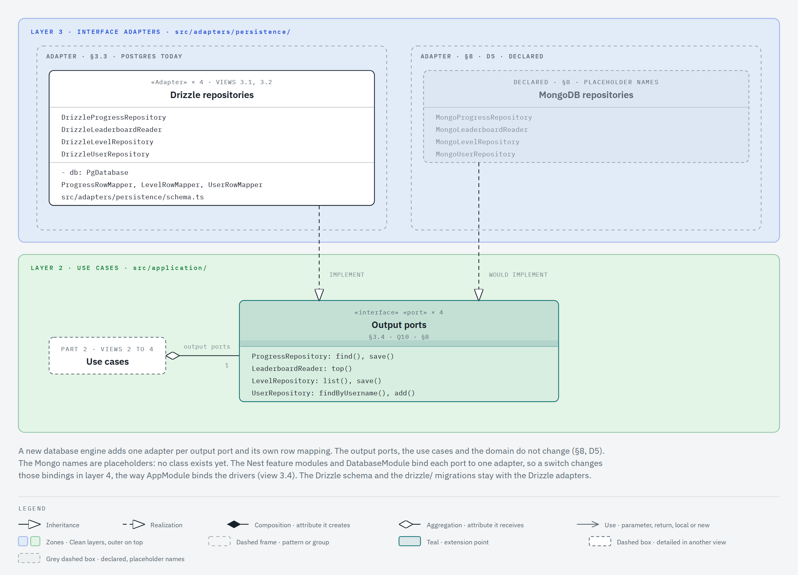

# Extensibility diagram

Status: draft for review with the team, 2026-10-31.

Statement §4 asks for an extensibility diagram with the engine in the center and the variants as extensions. Decision D6 and API-NFR-10 ask the API for the same standards and its own diagrams. The API has no game engine, so the application core sits in the center: `UseCase<TRequest, TResponse>` and the six use cases. The extension points around it use the names of the [class diagram](classes.md). IDs such as D5, DS-6 and API-FR-04 refer to [`docs/REQUIREMENTS.md`](../REQUIREMENTS.md). The variation register (§8) and the decisions D4 and D5 are in the app repo's canonical `docs/REQUIREMENTS.md` (rule R-requirements). The file-by-file steps of `docs/EXTENSIBILITY.md` are still to write; this page does not replace them.

## How to read it

- The colored zone is the Clean layer, with the colors of [layers.md](layers.md). The zones are bands, with the outer layer at the top and the inner layer at the bottom.
- The teal class is the extension point of the view. In view 1 it is `UseCase`, the contract of the application core.
- A dashed frame groups one extension axis or one pattern. Its label names the source, for example `DATABASE ENGINE · ADAPTER · §8`.
- A box with a plural name, such as `Output ports`, stands for a group. Its compartment lists the exact class names.
- A grey dashed box is a declared extension with no class yet. Its name is a placeholder. A grey italic member is a placeholder too.
- A white dashed box is a class that another view details, as in the class diagram.
- A realization arrow points from an extension to the contract it implements. A diamond says that a class keeps another class in an attribute: hollow (aggregation) when the value comes from outside, filled (composition) when the class creates it. The other end names the attribute and its multiplicity. A solid line with an open arrowhead and a verb is a use. The notation is the one of the [class diagram](classes.md).
- When a diamond starts or ends at a box with a plural name, its other end names the role of the group and the multiplicity for one member class, for example `input ports` and `1..2`.

## View 1: the core and its extension axes

Five axes surround the core. The drivers and the aspects sit in layer 4. The HTTP controllers and the database adapters sit in layer 3. The level validators of each variant sit in layer 1. Every arrow from layers 3 and 4 points to the core, so a new driver, aspect, controller or database adapter adds a class and the core does not change. The core points inward to layer 1 only through `LevelValidators`, a registry that the composition root fills: a new variant registers its validator there and changes no existing class. No source declares a second transport, so the HTTP controllers are the only input adapters, and the view draws no placeholder for another one.

## View 2: a new variant

The statement gives the example of a fifth variant: «por ejemplo, Hexa Fill: pintar celdas con restricciones» (§3.1). `FillSection` and `FillLevelValidator` are placeholders for it. They assume that Fill has level files; no source says so yet. The composition root registers `FillLevelValidator` for the `fill` game id, and no existing class changes.

## View 3: a new database engine

The database engine row of §8 names MongoDB instead of Postgres (professor, class of 2026-10-26). The `Mongo` class names are placeholders.

## Extension points

| Extension point                                   | A new extension adds                                                                                                                                                                                                                            | It does not change                                                                                                                                                                                                                                    |
| ------------------------------------------------- | ----------------------------------------------------------------------------------------------------------------------------------------------------------------------------------------------------------------------------------------------- | ----------------------------------------------------------------------------------------------------------------------------------------------------------------------------------------------------------------------------------------------------- |
| Variant with level files (Fill, §3.1)             | A section type (`FillSection`, placeholder), a `LevelValidator<TSection>` strategy (`FillLevelValidator`, placeholder) that checks the shape and the rules of the section, and one entry for its `gameId` in the composition root (decision 5). | `LevelDefinition<TSection>`, `LevelValidators`, `GameId`, `LevelRowMapper`, `LevelDto`, `LevelDtoMapper`, the use cases, the `LevelRepository` port and the levels table, which keeps the section in one JSON column (view 3.2 of the class diagram). |
| Variant with no level files (as Lines and Merge)  | Nothing: `GameId` is an open value object (decision 5). Lines and Merge have no level files (API-FR-04).                                                                                                                                        | The use cases: each one takes `gameId` as a parameter, never one per game ([layers.md](layers.md)). The tables, keyed by `gameId` (DS-5).                                                                                                             |
| Database engine (MongoDB, §8)                     | One adapter per output port with its row mapping (`Mongo` names are placeholders), and new bindings in the Nest feature modules and `DatabaseModule`.                                                                                           | The output ports, the use cases and the domain (§8, D5).                                                                                                                                                                                              |
| Driver                                            | One adapter that implements `PasswordHasher`, `TokenIssuer` or `Clock`, as `ScryptPasswordHasher`, `JwtTokenIssuer` and `SystemClock` do, and one binding in `AppModule`.                                                                       | The driver ports and the use cases (API-NFR-11).                                                                                                                                                                                                      |
| Aspect                                            | One subclass of `UseCaseAspect`, as `LoggingAspect` and `TimingAspect`. It wraps any use case.                                                                                                                                                  | The use cases (§3.5, API-NFR-07). Q12 decides the layer of the aspects.                                                                                                                                                                               |
| Input adapter (HTTP controller)                   | One controller that holds the input ports it calls, as `LevelsController` holds `GetLevels` and `UpdateLevels`.                                                                                                                                 | The input ports and the use cases. No source declares another transport.                                                                                                                                                                              |
| Topology (square, triangular or 3D cells; §8, D4) | One `Topology` class with its rotation steps and one entry for its `TopologyId` in the composition root. Nothing in the level schema: a coordinate is a tuple of numbers, and `topology` says how to read it (decision 6).                      | `LevelDefinition<TSection>`, `FitLevelValidator` and the levels table. The Fit check asks the topology for its rotation steps and never assumes 60°.                                                                                                  |

## Render the images

The views come from the HTML files in [`extensibility/views/`](extensibility/views/). They follow the same rules as the [class diagram](classes.md): each file holds one inline SVG drawn with the diagram-design skill and the HexaBlock profile. Open the file in a browser to see the drawing. The `.png` image next to it is that SVG rendered at scale 2 by a headless browser. After you edit a file, export the image again with `/diagram-design:export-diagram docs/architecture/extensibility/views/<view>.html --png-only`, then run `pnpm format`. Commit each `.html` file together with its `.png` image.
