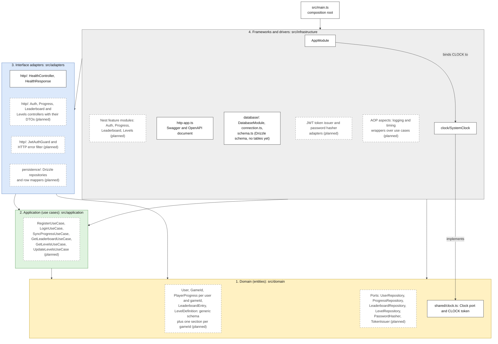

# Layers (Clean Architecture)

Status: draft for review with the professor, 2026-10-30.

This page shows the four Clean layers of the API (statement §3.4 and §4.2). It places each main component in its layer. The rules in [`.dependency-cruiser.cjs`](../../.dependency-cruiser.cjs) check the arrows on every `pnpm arch` run.

## Diagram

How to read it:

- Each arrow is an allowed source-code dependency. Every arrow points inward, toward the domain.
- A dashed box with the suffix "(planned)" is a component that does not exist yet. A solid box exists in `src/` today.
- Layer colors: yellow is the domain, green is the application, blue is the interface adapters, grey is frameworks and drivers.
- The clock is the real example of a port and its adapter. `Clock` lives in the domain. `SystemClock` in the infrastructure implements it. `AppModule` binds the `CLOCK` token to `SystemClock`.

## Layers and allowed dependencies

| Layer                      | Folder                                          | What lives there                                                                            | May depend on                                                                                                                                                                                                                                 |
| -------------------------- | ----------------------------------------------- | ------------------------------------------------------------------------------------------- | --------------------------------------------------------------------------------------------------------------------------------------------------------------------------------------------------------------------------------------------- |
| 1. Domain (entities)       | `src/domain`                                    | Entities, value objects, domain services and the ports they own.                            | Only `src/domain`. No package and no Node built-in. Rule `domain-imports-only-domain`.                                                                                                                                                        |
| 2. Application (use cases) | `src/application`                               | Use cases that orchestrate the domain through its ports.                                    | `src/application` and `src/domain`. No package, so no `@nestjs/*`. Rule `application-imports-only-domain`.                                                                                                                                    |
| 3. Interface adapters      | `src/adapters/http`, `src/adapters/persistence` | Nest controllers, DTOs, guards and filters. Drizzle repositories that implement the ports.  | `src/application`, `src/domain` and packages. Never `src/infrastructure`: rule `adapters-never-import-infrastructure`. `src/adapters/persistence` may use `drizzle-orm` but never `@nestjs/*`: rule `persistence-adapters-never-import-nest`. |
| 4. Frameworks and drivers  | `src/infrastructure`                            | Nest modules, configuration, the database connection and system adapters such as the clock. | Every layer and any package. No rule restricts it. The three rules above stop every inner layer from importing it.                                                                                                                            |
| Composition root           | `src/main.ts`                                   | Bootstrap: it creates the Nest app from `AppModule`.                                        | `src/infrastructure`. No rule restricts it.                                                                                                                                                                                                   |

## Where each piece lives

- **Entities and value objects:** `src/domain`. Examples: `User`, `GameId`, `PlayerProgress`, `LeaderboardEntry`, `LevelDefinition`. They carry no table IDs and no framework types.
- **Use cases:** `src/application`. There is one use case per action, parameterized by `gameId`, never one per game.
- **Ports:** `src/domain`, next to the entities that use them, as `src/domain/shared/clock.ts` does today. The persistence adapters implement these ports.
- **Controllers:** `src/adapters/http`. They translate HTTP requests into use case calls.
- **DTOs and validation:** `src/adapters/http`, next to their controllers. The domain checks its own rules, such as the Fit level check of assumption A5.
- **Drizzle schema:** `src/infrastructure/database/schema.ts` today. `drizzle-kit` reads it to write the migrations in `drizzle/`. See question 2.
- **Drizzle repositories and row mappers:** `src/adapters/persistence`. The mappers turn rows into entities and back.
- **JWT guard:** `src/adapters/http`. It verifies the token through the `TokenIssuer` port.
- **JWT and password hashing adapters:** `src/infrastructure`, as `SystemClock` does for the `Clock` port.
- **AOP aspects over use cases:** custom decorators or proxies, never Nest interceptors (rule `application-imports-only-domain`). This draft puts them in `src/infrastructure`. See question 3.
- **Swagger and OpenAPI:** `@nestjs/swagger` decorators on controllers and DTOs in `src/adapters/http`. `src/infrastructure/http-app.ts` builds the document. `openapi/openapi.json` is its committed export.
- **NestJS modules:** `src/infrastructure`. Nest stays out of `src/domain`, `src/application` and `src/adapters/persistence`. A Nest injection token in the domain is a plain `Symbol`, such as `CLOCK`.
- **Outside `src/`:** `drizzle/` holds the generated SQL migrations. `compose.yaml` starts a local Postgres. Both are database details of layer 4.

## Open questions for the professor

1. **Where do the ports live?** Statement §3.4 says the use cases depend on ports defined in their own layer. This repo defines its ports in `src/domain`, as `Clock` shows. Is a port in the domain acceptable, or must repository ports move to `src/application`?
2. **Where does the Drizzle schema live?** The table definitions sit in `src/infrastructure/database/schema.ts`. A Drizzle repository in `src/adapters/persistence` needs those tables, but rule `adapters-never-import-infrastructure` forbids that import. Should the schema move to `src/adapters/persistence`, as part of the persistence adapter?
3. **Where do the AOP aspects live?** An aspect wraps a use case. It can live in `src/application` as a plain decorator over a logger port, or in `src/infrastructure` as a wrapper that the Nest modules apply. Which layer do you expect?
