# Layers (Clean Architecture)

Status: draft for review with the professor, 2026-10-30. Q10 answered in the class of 2026-10-30; the ports moved to the application layer on 2026-10-31. Q12 answered in the session of 2026-11-06; the aspects moved to the application layer on 2026-11-06.

This page shows the four Clean layers of the API (statement §3.4 and §4.2). It places each main component in its layer. The rules in [`.dependency-cruiser.cjs`](../../.dependency-cruiser.cjs) forbid every outward import in `src/` on each `pnpm arch` run. They do not prove that each drawn arrow exists. Question IDs such as Q12 use the numbers of the shared question list in `hexablock-app`, `docs/REQUIREMENTS.md` §11. The classes of each layer are in [classes.md](classes.md). The extension points are in [extensibility.md](extensibility.md).

## Concentric view

Statement §4.2 asks for a visual representation of the four concentric layers. This view draws them as rings, with the legend inside the drawing. Every source dependency points toward the centre. The component diagram below gives the detail of each layer.

The view comes from [`layers/views/layers-1-rings.html`](layers/views/layers-1-rings.html), one inline SVG drawn with the diagram-design skill and the HexaBlock profile, as the class views are. The `.png` image next to it is that SVG rendered at scale 2 by a headless browser, in the page width that [«Render the images» of classes.md](classes.md#render-the-images) gives. Commit the `.html` file together with its `.png` image.

## Component diagram

```mermaid
flowchart TB
  MAIN["src/main.ts<br/>bootstrap"]

  subgraph INFRA["4. Frameworks and drivers: src/infrastructure"]
    APPMOD["AppModule<br/>composition root"]
    HTTPAPP["http-app.ts<br/>Swagger and OpenAPI document"]
    DB["database/: DatabaseModule, connection.ts"]
  end

  subgraph ADAPTERS["3. Interface adapters: src/adapters"]
    HEALTH["http/: HealthController, HealthResponse"]
    CONTROLLERS["http/: Auth, Progress, Leaderboard and<br/>Levels controllers with their DTOs<br/>and DTO mappers"]
    GUARD["http/: JwtAuthGuard and<br/>HttpErrorFilter"]
    REPOS["persistence/: Drizzle repositories,<br/>DrizzleLeaderboardReader and row mappers"]
    SCHEMA["persistence/schema.ts: Drizzle schema<br/>of users, progress, level_results, levels"]
    SYSCLOCK["clock/SystemClock"]
    SECURITY["jwt/JwtTokenIssuer, crypto/: ScryptPasswordHasher,<br/>RandomUserIdGenerator"]
    NESTLOGGER["logging/NestLogger"]
  end

  subgraph APP["2. Application (use cases): src/application"]
    INPORTS(["Input ports, one interface per use case:<br/>RegisterUser, Login, AuthenticateToken, SyncProgress,<br/>GetProgress, GetGlobalLeaderboard, GetLevelLeaderboard,<br/>GetLevels, UpdateLevels"])
    UC["RegisterUseCase, LoginUseCase, AuthenticateTokenUseCase,<br/>SyncProgressUseCase, GetProgressUseCase, GetGlobalLeaderboardUseCase,<br/>GetLevelLeaderboardUseCase, GetLevelsUseCase, UpdateLevelsUseCase"]
    REPOPORTS(["Output ports: UserRepository, ProgressRepository,<br/>GlobalBoardReader, LevelBoardReader, LevelRepository"])
    SECPORTS(["PasswordHasher, TokenIssuer and<br/>UserIdGenerator ports"])
    CLOCK(["Clock port and CLOCK token<br/>ports/clock.ts"])
    ASPECTS["aspects/: UseCaseAspect, LoggingAspect"]
    TIMING["aspects/: TimingAspect (planned)"]
    LOGPORT(["Logger port and LOGGER token<br/>ports/logger.ts"])
  end

  subgraph DOMAIN["1. Domain (entities): src/domain"]
    ENT["User, GameId, PlayerProgress aggregate per ProgressKey<br/>with its LevelResults, Standing,<br/>LevelDefinition: common part plus a typed section<br/>per gameId, LevelValidators: one registered<br/>LevelValidator per gameId with levels"]
  end

  MAIN --> INFRA
  INFRA --> ADAPTERS
  INFRA --> APP
  INFRA --> DOMAIN
  ADAPTERS --> APP
  ADAPTERS --> DOMAIN
  APP --> DOMAIN
  SYSCLOCK -.->|implements| CLOCK
  APPMOD -->|binds CLOCK to| SYSCLOCK
  NESTLOGGER -.->|implements| LOGPORT
  ASPECTS -->|uses| LOGPORT
  CONTROLLERS -->|calls| INPORTS
  GUARD -->|calls| INPORTS
  UC -.->|implements| INPORTS
  ASPECTS -.->|implements| INPORTS
  UC -->|uses| REPOPORTS
  UC -->|uses| SECPORTS
  REPOS -.->|implements| REPOPORTS
  SECURITY -.->|implements| SECPORTS
  REPOS -->|queries tables of| SCHEMA
  DB -->|passes to Drizzle| SCHEMA
  APPMOD -->|imports| DB
  APPMOD -->|registers| HEALTH
  APPMOD -->|registers| CONTROLLERS

  subgraph LEGEND["Legend"]
    direction LR
    KEY4["Layer 4: dark blue"]
    KEY3["Layer 3: light blue"]
    KEY2["Layer 2: purple"]
    KEY1["Layer 1: yellow"]
    KEYPORT(["Rounded node: a port"])
    KEYPLANNED["Dashed box: planned"]
    KEYIMPL["Dotted arrow labelled implements:<br/>realization"]
  end

  %% Invisible links keep the layers stacked from outer to inner, with the legend last.
  HEALTH & CONTROLLERS & GUARD ~~~ UC
  UC ~~~ ENT
  ENT ~~~ KEY4

  classDef real fill:#ffffff,stroke:#222222,color:#111111
  classDef planned fill:#ffffff,stroke:#777777,stroke-dasharray:5 5,color:#444444
  class MAIN,APPMOD,HTTPAPP,DB,SYSCLOCK,NESTLOGGER,HEALTH,SCHEMA,CLOCK,ASPECTS,LOGPORT real
  class SECURITY,CONTROLLERS,GUARD,REPOS,UC,INPORTS,ENT,REPOPORTS,SECPORTS real
  class TIMING planned
  class KEYPORT,KEYIMPL real
  class KEYPLANNED planned

  style INFRA fill:#cfdcf3,stroke:#1e3a8a,color:#111111
  style ADAPTERS fill:#e2ebf8,stroke:#1d4ed8,color:#111111
  style APP fill:#efe7f8,stroke:#7e22ce,color:#111111
  style DOMAIN fill:#f9f4dc,stroke:#b45309,color:#111111
  style LEGEND fill:#ffffff,stroke:#777777,color:#111111
  style KEY4 fill:#cfdcf3,stroke:#1e3a8a,color:#111111
  style KEY3 fill:#e2ebf8,stroke:#1d4ed8,color:#111111
  style KEY2 fill:#efe7f8,stroke:#7e22ce,color:#111111
  style KEY1 fill:#f9f4dc,stroke:#b45309,color:#111111
```

How to read it:

- The concentric view above answers statement §4.2. Mermaid cannot draw rings, so this diagram stacks the same layers: the outer layer is at the top and the domain, the center, is at the bottom.
- Each arrow is a source-code dependency that the rules allow. No arrow points outward, away from the domain. Some arrows stay inside one layer, such as `AppModule` importing `DatabaseModule`.
- A rounded node is a port: an interface that an inner layer owns and an outer layer implements.
- A dotted arrow labelled `implements` is a realization: the class implements the port. Mermaid cannot draw the hollow triangle of UML, so the dotted line stands for it, as in the layers page of `hexablock-app`. A solid arrow is any other dependency.
- A dashed box with the suffix "(planned)" is a component that does not exist yet. A solid box exists in `src/` today.
- A label that names an open question marks a placement the team has not settled. The box sits where this draft puts it, and the professor's answer can move it. No label names an open question today.
- Layer colors: yellow is the domain, purple is the application, and blue is the infrastructure. With four layers, the infrastructure has two shades: light blue for the interface adapters (layer 3) and dark blue for frameworks and drivers (layer 4). These are the colors the course uses for its three layers. The legend inside each drawing repeats them, and the class and extensibility views use the same zone colors.
- The clock is the real example of a port and its adapter. `Clock` lives in `src/application/ports/clock.ts`. `SystemClock` in `src/adapters/clock` implements it. `AppModule` binds the `CLOCK` token to `SystemClock`. The logger follows the same shape: `NestLogger` implements the `Logger` port, and `AppModule` binds the `LOGGER` token to it.
- Every port lives in the application layer (Q10). Domain code never imports a port: a use case reads the instant from `Clock` and passes it to the domain as a parameter. One interface of the domain has its implementation outside the domain: `PasswordVerifier` in `src/domain/user`, which `User.passwordMatches()` asks. The port `PasswordHasher` extends it, so the infrastructure implements it through the port. The class of 2026-11-13 allows this exception to Q10: when the domain needs something that the infrastructure gives, the interface lives in the domain and the implementation lives outside. That is dependency inversion, so no dependency rule breaks (decisions 1 and 16 of [classes.md](classes.md)).
- `AppModule` is the composition root: it binds each port to its adapter. `src/main.ts` is the bootstrap: it creates the Nest app from `AppModule` and starts the HTTP server.

## Layer 3 or layer 4: the role decides

The role of a class decides its layer, in the API and in the app.

- **Layer 3, `src/adapters/`.** Every class that implements a port of layer 2, and the other code that the team writes to convert data between the form of the use cases and the form of an outside technology. Examples: controllers, guards, the error filter, DTOs, DTO mappers, repository implementations and row mappers, and the adapters of the system services: the clock, the random source, password hashing, token signing and logging.
- **Layer 4, `src/infrastructure/` and `src/main.ts`.** Glue code only: the implementations of interfaces that layer 3 owns, the configuration, the database connection, the composition root `AppModule` and the bootstrap `src/main.ts`. No class of layer 4 implements a port of layer 2. Rule `infrastructure-imports-no-port` checks it: no file of `src/infrastructure` except `app.module.ts` imports `src/application/ports`. `AppModule` imports the tokens and the types of the ports to bind them.

This is option C of [#212](https://github.com/Hexablock-Suite/hexablock-api/issues/212), decided on 2026-11-26. A clock, a token signer and a logger convert data between the domain form and the form of an outside library, as a repository does (statement §3.4; Martin, _Clean Architecture_, ch. 22). So one rule places the adapter of every port, and the two definitions above do not overlap. `SystemClock`, `ScryptPasswordHasher`, `RandomUserIdGenerator`, `JwtTokenIssuer` and `NestLogger` moved from `src/infrastructure` to layer 3. `auth-config.ts` stays in `src/infrastructure/auth`: it reads the environment and builds the `JwtService` that `JwtTokenIssuer` receives.

Each folder of layer 3 names the one library that it adapts, and a rule of [`.dependency-cruiser.cjs`](../../.dependency-cruiser.cjs) checks it:

- `src/adapters/http` imports only `@nestjs/*` among packages. Rule `http-adapters-import-only-nest`.
- `src/adapters/persistence` imports only `drizzle-orm` among packages. Rule `persistence-adapters-import-only-drizzle`. Rule `persistence-adapters-never-import-nest` gives the clearer message for `@nestjs/*`.
- `src/adapters/jwt` imports only `@nestjs/jwt` among packages. Rule `jwt-adapters-import-only-nest-jwt`. `JwtTokenIssuer` lives there.
- `src/adapters/logging` imports only `@nestjs/common` among packages. Rule `logging-adapters-import-only-nest-common`. `NestLogger` lives there.
- `src/adapters/crypto` imports only `node:crypto` among the Node built-ins. Rule `crypto-adapters-import-only-node-crypto`. `ScryptPasswordHasher` and `RandomUserIdGenerator` live there.
- `src/adapters/clock` imports no Node built-in: the system clock is the `Date` global of JavaScript. Rule `clock-adapters-import-no-built-in`. `SystemClock` lives there.
- Every other file of `src/adapters`, today `received.ts`, `built.ts` and the folders `crypto/` and `clock/`, imports no package. Rule `other-adapters-import-no-package`. So a new folder of layer 3 gets its own rule before it imports its library.
- A Node built-in is not a package, and the rules allow it. `http-error.filter.ts` reads `STATUS_CODES` of `node:http`.

The folders `http` and `persistence` of layer 3 never import each other. A controller talks to use cases only, and a repository knows no request. Rule `http-adapters-never-import-persistence` checks `src/adapters/http`, and rule `persistence-adapters-never-import-http` checks `src/adapters/persistence`.

**The limit.** A replacement of the web framework rewrites the files of `src/adapters/http`, `src/adapters/jwt` and `src/adapters/logging` that import `@nestjs/*`, and the Nest files of layer 4. A replacement of the database rewrites `src/adapters/persistence`. No code of layers 1 and 2 changes in either case. The app keeps a stricter rule: its layer 3 imports no package at all (rule `adapters-imports-only-inner-layers` of `hexablock-app`). The API cannot follow it at no cost, because a Nest controller needs the decorators of `@nestjs/common`.

## Layers and allowed dependencies

| Layer                      | Folder                                                                                                                                   | What lives there                                                                                                                                                                                                                                         | May depend on                                                                                                                                                                                                                                                                                                                                                                                                                                                                                                                                                                                                                                                                                                                                                                                                                                                                                                                                                                                                                                                                                       |
| -------------------------- | ---------------------------------------------------------------------------------------------------------------------------------------- | -------------------------------------------------------------------------------------------------------------------------------------------------------------------------------------------------------------------------------------------------------- | --------------------------------------------------------------------------------------------------------------------------------------------------------------------------------------------------------------------------------------------------------------------------------------------------------------------------------------------------------------------------------------------------------------------------------------------------------------------------------------------------------------------------------------------------------------------------------------------------------------------------------------------------------------------------------------------------------------------------------------------------------------------------------------------------------------------------------------------------------------------------------------------------------------------------------------------------------------------------------------------------------------------------------------------------------------------------------------------------- |
| 1. Domain (entities)       | `src/domain`                                                                                                                             | Entities, value objects and domain services. No ports (Q10): the instant is a parameter.                                                                                                                                                                 | Only `src/domain`. No package and no Node built-in. Rule `domain-imports-only-domain`.                                                                                                                                                                                                                                                                                                                                                                                                                                                                                                                                                                                                                                                                                                                                                                                                                                                                                                                                                                                                              |
| 2. Application (use cases) | `src/application`                                                                                                                        | Use cases, input ports, output ports that the adapters implement (Q10), and the aspects.                                                                                                                                                                 | `src/application` and `src/domain`. No package, so no `@nestjs/*`. Rule `application-imports-only-domain`.                                                                                                                                                                                                                                                                                                                                                                                                                                                                                                                                                                                                                                                                                                                                                                                                                                                                                                                                                                                          |
| 3. Interface adapters      | `src/adapters/http`, `src/adapters/persistence`, `src/adapters/jwt`, `src/adapters/crypto`, `src/adapters/clock`, `src/adapters/logging` | Every class that implements a port of layer 2 (#212, option C). Nest controllers, DTOs, guards and filters. Drizzle repositories. The adapters of the system services: the clock, the logger, token signing, password hashing and the user id generator. | `src/application` and `src/domain`. Never `src/infrastructure`: rule `adapters-never-import-infrastructure`. Each folder names the one library that it adapts. `src/adapters/http` imports only `@nestjs/*` among packages: rule `http-adapters-import-only-nest`. `src/adapters/persistence` imports only `drizzle-orm` among packages: rule `persistence-adapters-import-only-drizzle`, and rule `persistence-adapters-never-import-nest` reports `@nestjs/*`. `src/adapters/jwt` imports only `@nestjs/jwt`: rule `jwt-adapters-import-only-nest-jwt`. `src/adapters/logging` imports only `@nestjs/common`: rule `logging-adapters-import-only-nest-common`. `src/adapters/crypto` imports only `node:crypto` among the Node built-ins: rule `crypto-adapters-import-only-node-crypto`. `src/adapters/clock` imports no Node built-in: rule `clock-adapters-import-no-built-in`. Every other file of `src/adapters`, such as `received.ts` and `built.ts`, and the folders `crypto/` and `clock/` import no package: rule `other-adapters-import-no-package`. A Node built-in is not a package. |
| 4. Frameworks and drivers  | `src/infrastructure`                                                                                                                     | Glue code only: Nest modules, configuration, the database connection and the composition root. The implementations of interfaces that layer 3 owns. No class here implements a port of layer 2.                                                          | Every layer and any package. Rule `infrastructure-imports-no-port`: no file except `app.module.ts` imports `src/application/ports`. The rules of layers 1 to 3 stop every inner layer from importing it.                                                                                                                                                                                                                                                                                                                                                                                                                                                                                                                                                                                                                                                                                                                                                                                                                                                                                            |
| Bootstrap                  | `src/main.ts`                                                                                                                            | It creates the Nest app from `AppModule`, the composition root, and starts the server.                                                                                                                                                                   | `src/infrastructure`. No rule restricts it.                                                                                                                                                                                                                                                                                                                                                                                                                                                                                                                                                                                                                                                                                                                                                                                                                                                                                                                                                                                                                                                         |

## Where each piece lives

- **Entities and value objects:** `src/domain`. Examples: `User`, `GameId`, `PlayerProgress`, `Standing`, `LevelDefinition`. They carry no table IDs and no framework types.
- **Use cases:** `src/application`. There is one use case per action, parameterized by `gameId`, never one per game. A use case returns an expected failure as a `Result<T, E>` value, never as an exception, so no domain error crosses the input port.
- **Input ports:** `src/application`, one port per use case: `RegisterUser`, `Login`, `AuthenticateToken`, `SyncProgress`, `GetProgress`, `GetGlobalLeaderboard`, `GetLevelLeaderboard`, `GetLevels` and `UpdateLevels`. Each port binds the one generic interface `UseCase<TRequest, TResponse>` and declares no `execute()` of its own, and its error type is an object with a `kind` (decision 7 of [classes.md](classes.md)). The controllers and the guard depend on the port, not on the class. Each use case implements its port, and each AOP aspect implements `UseCase` to wrap it (§3.5). Tests call the same ports.
- **Ports:** `src/application`, next to the use cases that use them (Q10). The adapters of layer 3 implement these ports. `src/application/ports/clock.ts` holds the `Clock` port. `src/application/ports/leaderboard-entry.ts` holds `LeaderboardEntry`, the response type that the `GlobalBoardReader` and `LevelBoardReader` ports return. It is an alias of `BoardEntry` of `src/domain/progress/ranked-board.ts`, the entry that `RankedBoard.of()` takes (#213). The request and response types of an input port live next to its use case, not in `ports/`: `ListedLevels` in `src/application/levels/listed-levels.ts` and `SessionToken` in `src/application/auth/session-token.ts`.
- **Composition root:** `AppModule` in `src/infrastructure`. It registers every controller and binds each port to one adapter, the repositories included, over the database connection that `DatabaseModule` gives. `src/main.ts` only starts the app.
- **Controllers:** `src/adapters/http`. They translate HTTP requests into use case calls.
- **HTTP mappers:** `src/adapters/http`, next to the controllers. `AuthDtoMapper`, `ProgressDtoMapper`, `LevelDtoMapper` and `LeaderboardDtoMapper` translate between DTOs and entities, as the row mappers do for persistence. They build the domain values of each request, so a use case never builds one ([#105](https://github.com/Hexablock-Suite/hexablock-api/issues/105) for the account use cases). The mapper also writes the text of a failed `Result`: `LevelDtoMapper.toDetails()`, `ProgressDtoMapper.toProblemDetails()` and `LeaderboardDtoMapper.toProblemDetails()` give its lines. The controller only throws the exception with the status, and `HttpErrorFilter` writes the error body of API-FR-06 ([#215](https://github.com/Hexablock-Suite/hexablock-api/issues/215)).
- **DTOs and validation:** `src/adapters/http`, next to their controllers. A DTO checks the shape of the common part. The domain checks its own rules, such as the Fit level check of assumption A5, and the validator registered for a `gameId` checks the section.
- **Drizzle schema:** `src/adapters/persistence/schema.ts`, next to the repositories that query its tables. `drizzle-kit` reads it to write the migrations in `drizzle/`, and `src/infrastructure/database/connection.ts` passes it to Drizzle. See Q11.
- **Drizzle repositories and row mappers:** `src/adapters/persistence`. The mappers turn rows into entities and back.
- **JWT guard:** `src/adapters/http`. It calls the `AuthenticateToken` input port, as a controller calls its input ports, and never calls `TokenIssuer`. `AuthenticateTokenUseCase` verifies the token through the `TokenIssuer` port, asks the `UserRepository` port if its user is still stored ([#137](https://github.com/Hexablock-Suite/hexablock-api/issues/137)), and returns the `UserId` or a failed `Result`. The docs named two options, a separate `TokenVerifier` port or an `AuthenticateToken` input port. This draft takes the input port, as an assumption for team review: decision 14 of [classes.md](classes.md).
- **Adapters of the system services:** layer 3, one folder per library (#212, option C). `JwtTokenIssuer` is in `src/adapters/jwt`, `ScryptPasswordHasher` and `RandomUserIdGenerator` are in `src/adapters/crypto`, `SystemClock` is in `src/adapters/clock` and `NestLogger` is in `src/adapters/logging`. `auth-config.ts` stays in `src/infrastructure/auth`: it reads the environment and builds the `JwtService` of `JwtTokenIssuer`.
- **AOP aspects over use cases:** `src/application/aspects`, as custom decorators, never Nest interceptors (rule `application-imports-only-domain`). `UseCaseAspect` implements `UseCase`, the generic interface that each input port binds, and each aspect extends it. See Q12.
- **Logging:** the `Logger` port lives in `src/application/ports/logger.ts`. It takes a typed entry (use case name, outcome, and the `kind` of a failure, or the name, string `code` and stack frames of a thrown error, never its message, or the `gameId`, `levelId` and reason code of a stored level row that breaks a rule). `NestLogger` in `src/adapters/logging` implements it and writes the text (decision 10 of [classes.md](classes.md)). A failure logs only its `kind`, so a value that the client sent never reaches the log.
- **Swagger and OpenAPI:** `@nestjs/swagger` decorators on controllers and DTOs in `src/adapters/http`. `src/infrastructure/http-app.ts` builds the document. `openapi/openapi.json` is its committed export.
- **NestJS modules:** `src/infrastructure`. Nest stays out of `src/domain`, `src/application` and `src/adapters/persistence`. A Nest injection token next to a port is a plain `Symbol`, such as `CLOCK`.
- **Outside `src/`:** `drizzle/` holds the generated SQL migrations. `compose.yaml` starts a local Postgres. Both are database details of layer 4.

## Open questions for the professor

None today.

## Resolved questions

- **Q10. Answered in the class of 2026-10-30: the ports live in `src/application`.** The professor said that the ports belong to the application layer. Statement §3.4 says the same: the use cases depend on ports defined in their own layer. The diagram and the class diagram put every port there. The `Clock` port moved to `src/application/ports/clock.ts` on 2026-10-31.
- **Q11. Resolved by the team on 2026-10-30: the Drizzle schema lives in `src/adapters/persistence/schema.ts`.** It sat in `src/infrastructure/database/schema.ts`, and rule `adapters-never-import-infrastructure` kept the repositories from importing it. The infrastructure may import the adapters, so `connection.ts` now takes the schema from there. The architecture gate test pins the path that `drizzle.config.ts` gives to `drizzle-kit`.
- **Q12. Answered in the session of 2026-11-06: the aspects live in `src/application`.** An aspect wraps a use case. It could live in `src/application` as a plain decorator over a logger port, or in `src/infrastructure` as a wrapper that the Nest modules apply. The professor answered that the aspects talk to the use case, so they belong in the application layer, built as decorators with one interface common to the use cases, without libraries. `UseCaseAspect` and `LoggingAspect` moved to `src/application/aspects` on 2026-11-06, behind the `Logger` port that `NestLogger` implements.
