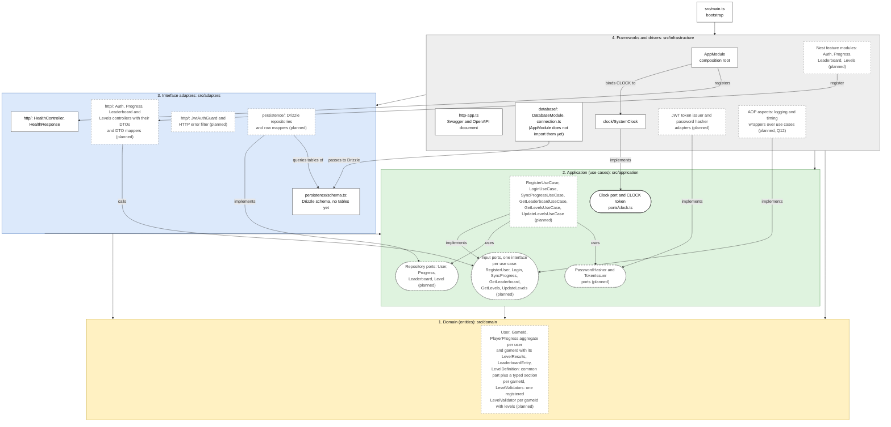

# Layers (Clean Architecture)

Status: draft for review with the professor, 2026-10-30. Q10 answered in the class of 2026-10-30; the ports moved to the application layer on 2026-10-31.

This page shows the four Clean layers of the API (statement §3.4 and §4.2). It places each main component in its layer. The rules in [`.dependency-cruiser.cjs`](../../.dependency-cruiser.cjs) forbid every outward import in `src/` on each `pnpm arch` run. They do not prove that each drawn arrow exists. Question IDs such as Q12 use the numbers of the shared question list in `hexablock-app`, `docs/REQUIREMENTS.md` §11. The classes of each layer are in [classes.md](classes.md). The extension points are in [extensibility.md](extensibility.md).

## Diagram

How to read it:

- Statement §4.2 asks for four concentric layers. Mermaid draws them as a stack: the outer layer is at the top and the domain, the center, is at the bottom.
- Each arrow is a source-code dependency that the rules allow. No arrow points outward, away from the domain. Some arrows stay inside one layer, such as `AppModule` binding `CLOCK` to `SystemClock`.
- A rounded node is a port: an interface that an inner layer owns and an outer layer implements.
- A dashed box with the suffix "(planned)" is a component that does not exist yet. A solid box exists in `src/` today.
- A label that names a question (Q12) marks a placement the team has not settled. The box sits where this draft puts it, and the professor's answer can move it.
- Layer colors: yellow is the domain, green is the application, blue is the interface adapters, grey is frameworks and drivers.
- The clock is the real example of a port and its adapter. `Clock` lives in `src/application/ports/clock.ts`. `SystemClock` in the infrastructure implements it. `AppModule` binds the `CLOCK` token to `SystemClock`.
- Every port lives in the application layer (Q10). Domain code never imports a port: a use case reads the instant from `Clock` and passes it to the domain as a parameter.
- `AppModule` is the composition root: it binds each port to its adapter. `src/main.ts` is the bootstrap: it creates the Nest app from `AppModule` and starts the HTTP server.

## Layers and allowed dependencies

| Layer                      | Folder                                          | What lives there                                                                            | May depend on                                                                                                                                                                                                                                 |
| -------------------------- | ----------------------------------------------- | ------------------------------------------------------------------------------------------- | --------------------------------------------------------------------------------------------------------------------------------------------------------------------------------------------------------------------------------------------- |
| 1. Domain (entities)       | `src/domain`                                    | Entities, value objects and domain services. No ports (Q10): the instant is a parameter.    | Only `src/domain`. No package and no Node built-in. Rule `domain-imports-only-domain`.                                                                                                                                                        |
| 2. Application (use cases) | `src/application`                               | Use cases, input ports and the output ports that the adapters implement (Q10).              | `src/application` and `src/domain`. No package, so no `@nestjs/*`. Rule `application-imports-only-domain`.                                                                                                                                    |
| 3. Interface adapters      | `src/adapters/http`, `src/adapters/persistence` | Nest controllers, DTOs, guards and filters. Drizzle repositories that implement the ports.  | `src/application`, `src/domain` and packages. Never `src/infrastructure`: rule `adapters-never-import-infrastructure`. `src/adapters/persistence` may use `drizzle-orm` but never `@nestjs/*`: rule `persistence-adapters-never-import-nest`. |
| 4. Frameworks and drivers  | `src/infrastructure`                            | Nest modules, configuration, the database connection and system adapters such as the clock. | Every layer and any package. No rule restricts it. The three rules above stop every inner layer from importing it.                                                                                                                            |
| Bootstrap                  | `src/main.ts`                                   | It creates the Nest app from `AppModule`, the composition root, and starts the server.      | `src/infrastructure`. No rule restricts it.                                                                                                                                                                                                   |

## Where each piece lives

- **Entities and value objects:** `src/domain`. Examples: `User`, `GameId`, `PlayerProgress`, `LeaderboardEntry`, `LevelDefinition`. They carry no table IDs and no framework types.
- **Use cases:** `src/application`. There is one use case per action, parameterized by `gameId`, never one per game. A use case returns an expected failure as a `Result<T, E>` value, never as an exception, so no domain error crosses the input port.
- **Input ports:** `src/application`, one interface per use case: `RegisterUser`, `Login`, `SyncProgress`, `GetLeaderboard`, `GetLevels` and `UpdateLevels`. The controllers depend on the interface, not on the class. Each use case implements its interface, and each AOP aspect implements the same interface to wrap it (§3.5). Tests call the same interfaces.
- **Ports:** `src/application`, next to the use cases that use them (Q10). The persistence adapters and the system adapters implement these ports. `src/application/ports/clock.ts` holds the `Clock` port.
- **Composition root:** `AppModule` in `src/infrastructure`. It binds each port to one adapter, and the feature modules do the same for their repositories. `src/main.ts` only starts the app.
- **Controllers:** `src/adapters/http`. They translate HTTP requests into use case calls.
- **HTTP mappers:** `src/adapters/http`, next to the controllers. `ProgressDtoMapper` and `LevelDtoMapper` translate between DTOs and entities, as the row mappers do for persistence. A controller also turns a failed `Result` into the error body of API-FR-06.
- **DTOs and validation:** `src/adapters/http`, next to their controllers. A DTO checks the shape of the common part. The domain checks its own rules, such as the Fit level check of assumption A5, and the validator registered for a `gameId` checks the section.
- **Drizzle schema:** `src/adapters/persistence/schema.ts`, next to the repositories that query its tables. `drizzle-kit` reads it to write the migrations in `drizzle/`, and `src/infrastructure/database/connection.ts` passes it to Drizzle. See Q11.
- **Drizzle repositories and row mappers:** `src/adapters/persistence`. The mappers turn rows into entities and back.
- **JWT guard:** `src/adapters/http`. It verifies the token through the `TokenIssuer` port. This is open for the team: the guard receives requests, but `TokenIssuer` is a port the use cases call, so the guard skips the use cases. `TokenIssuer` also only issues tokens. The team will choose between a separate `TokenVerifier` port and an `AuthenticateToken` input port.
- **JWT and password hashing adapters:** `src/infrastructure`, as `SystemClock` does for the `Clock` port.
- **AOP aspects over use cases:** custom decorators or proxies, never Nest interceptors (rule `application-imports-only-domain`). This draft puts them in `src/infrastructure`. See Q12.
- **Logging:** this draft has no `Logger` port. The aspects sit in `src/infrastructure` and call a logging package directly, so a port would protect no inner layer. If Q12 moves the aspects to `src/application`, they need a `Logger` port there.
- **Swagger and OpenAPI:** `@nestjs/swagger` decorators on controllers and DTOs in `src/adapters/http`. `src/infrastructure/http-app.ts` builds the document. `openapi/openapi.json` is its committed export.
- **NestJS modules:** `src/infrastructure`. Nest stays out of `src/domain`, `src/application` and `src/adapters/persistence`. A Nest injection token next to a port is a plain `Symbol`, such as `CLOCK`.
- **Outside `src/`:** `drizzle/` holds the generated SQL migrations. `compose.yaml` starts a local Postgres. Both are database details of layer 4.

## Open questions for the professor

- **Q12. Where do the AOP aspects live?** An aspect wraps a use case. It can live in `src/application` as a plain decorator over a logger port, or in `src/infrastructure` as a wrapper that the Nest modules apply. Which layer do you expect?

## Resolved questions

- **Q10. Answered in the class of 2026-10-30: the ports live in `src/application`.** The professor said: «Los puertos están en la capa de aplicación.» [26:41] (tip 21). Statement §3.4 says the same: the use cases depend on ports defined in their own layer. The diagram and the class diagram put every port there. The `Clock` port moved to `src/application/ports/clock.ts` on 2026-10-31.
- **Q11. Resolved by the team on 2026-10-30: the Drizzle schema lives in `src/adapters/persistence/schema.ts`.** It sat in `src/infrastructure/database/schema.ts`, and rule `adapters-never-import-infrastructure` kept the repositories from importing it. The infrastructure may import the adapters, so `connection.ts` now takes the schema from there. The architecture gate test pins the path that `drizzle.config.ts` gives to `drizzle-kit`.
